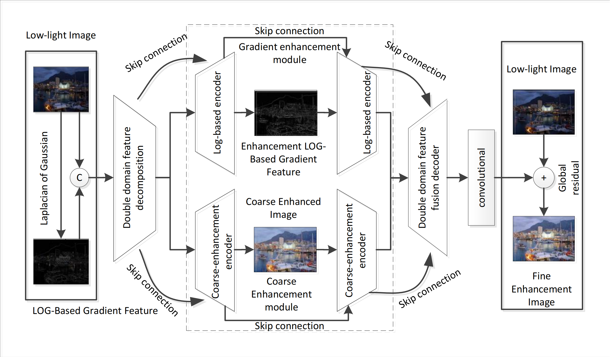
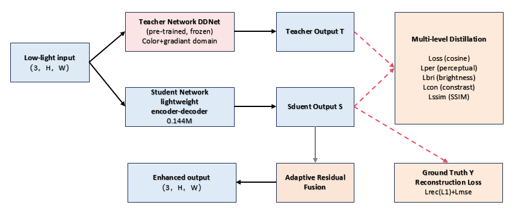
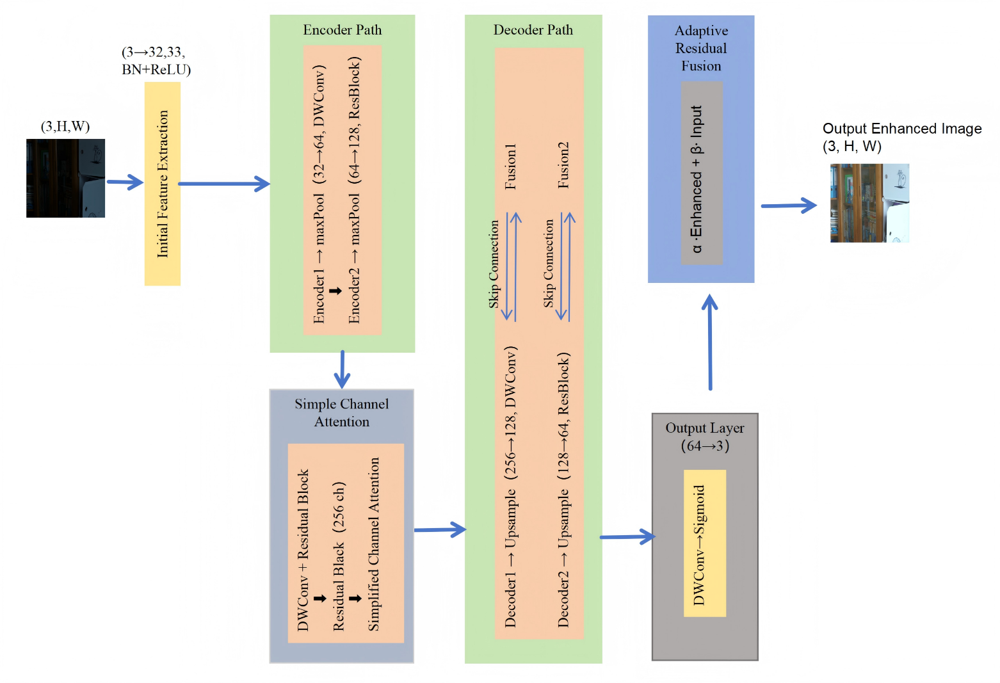

# Research on a Real-Time Low-Light Image Enhancement Lightweight Network Based on Knowledge Distillation

**Sihai You, Xin Zhao**

---

## Abstract

To address the issues of high computational complexity and difficulty in deploying existing low-light image enhancement models on mobile devices, this paper proposes a real-time low-light image enhancement method based on knowledge distillation. This method constructs a teacher-student network architecture: using the high-performance DDNet as the teacher model to guide the learning of the student model—a self-designed lightweight encoder-decoder network. By designing a multi-level distillation loss function, the enhancement capability of the teacher model is efficiently transferred to the student model. Experimental results on the LOL dataset show that the proposed student model achieves a favorable trade-off between enhancement quality and efficiency while being extremely lightweight: it uses only 2.7% of the teacher model's parameters (0.144 M vs 5.39 M), requires 15.3× fewer FLOPs (7.22 vs 110.51 GMac), and runs 16.2× faster (2.74 ms vs 44.36 ms per image, 365 FPS). In terms of enhancement quality, the student model attains visual fidelity comparable to that of the teacher model (PSNR 21.35 dB, SSIM 0.87 vs 0.86) and perceptual quality superior to the teacher (PIQE 22.39 vs 26.81) together with the best brightness uniformity (0.79). Ablation experiments verify the effectiveness of core components such as the attention mechanism. Beyond 365 FPS on a datacenter GPU, the student is benchmarked on an NVIDIA Jetson Orin Nano Super edge device, where it reaches 15.02 FPS in FP32 and 21.73 FPS in FP16 (46.02 ms) with less than 0.5 GB of peak memory, approaching the real-time video threshold and confirming its practical deployability on resource-constrained edge devices.

**Index Terms** — Low-light image enhancement, Knowledge distillation, Lightweight neural networks, Real-time image processing, Deep learning.

---

## I. Introduction

Image acquisition under low-light conditions is a long-standing fundamental challenge in the field of computer vision. In numerous practical application scenarios such as nighttime surveillance, autonomous driving, medical imaging, and mobile photography, insufficient lighting often leads to problems such as low brightness, attenuated contrast, color distortion, and significant noise in images, severely limiting the accuracy and reliability of subsequent high-level vision tasks (e.g., object detection, semantic segmentation, face recognition, shadow detection) [1], [2], [3], [4], [5]. Therefore, researching efficient and robust low-light image enhancement technology is of significant theoretical importance and practical value for improving the performance of visual systems under complex lighting conditions.

In recent years, with the rapid development of deep learning, low-light enhancement methods based on Convolutional Neural Networks (CNNs) and Transformers have achieved breakthrough progress. These methods, through end-to-end learning, can implicitly learn illumination mapping and feature reconstruction from large amounts of data, significantly surpassing traditional methods based on histogram equalization [28] and Retinex theory [7] in terms of image quality. However, current mainstream deep models (e.g., KinD [8], RUAS [9], URetinex-Net [10]) generally face problems such as large parameter counts, high computational complexity, and slow inference speeds [11], making them difficult to deploy in real-time on mobile terminals, embedded devices, or edge computing platforms (e.g., the Jetson series) with limited computational resources, thereby restricting their wide application in real-world scenarios.

Knowledge distillation, as an effective model compression and performance transfer technique, guides a lightweight student model to mimic the output or intermediate features of a complex teacher model during training, enabling significant reduction in model size while maintaining or even improving performance [12], [13]. This technique has achieved success in various vision tasks such as image classification [14], [15], object detection [16], [17], [18], and super-resolution [19], [20], [21]. However, in the specific field of low-light image enhancement, the application of knowledge distillation is still in its preliminary stages and faces the following core challenges [22], [23], [24]: First, student models often struggle to surpass teacher models on key quality metrics (e.g., PSNR, SSIM). Second, while achieving model lightweighting and inference acceleration, it is also necessary to maintain the natural reconstruction ability for image details, contrast, and color. Third, there is a lack of specialized distillation strategies and loss functions designed for low-light characteristics.

Addressing the aforementioned challenges and demands, this paper proposes a lightweight low-light image enhancement network based on multi-level knowledge distillation. The main contributions of this paper are as follows:

- **Architecture Design:** A lightweight student network based on an encoder-decoder structure is constructed, incorporating enhanced depthwise separable convolutions and a dual attention mechanism. This significantly improves inference efficiency on edge devices while ensuring enhancement performance.
- **Innovation in Distillation Strategy:** A multi-level distillation loss function is designed, encompassing output distribution, deep features, local contrast, and global brightness consistency. This enables the student model to comprehensively inherit the enhancement capability of the teacher model, attaining enhancement quality competitive with the teacher model while drastically reducing model size and latency.
- **Comprehensive Experimental Validation:** Systematic quantitative, real-time, and visual comparison experiments are conducted on public low-light datasets. The results show that the proposed method achieves a favorable trade-off between enhancement quality and inference speed: it runs at 365 FPS (2.74 ms per frame) on a datacenter GPU and at 15.02–21.73 FPS on a low-power NVIDIA Jetson Orin Nano Super edge device, providing a reliable solution for the practical deployment of low-light enhancement technology in mobile and embedded environments.

The structure of the subsequent chapters of this paper is as follows: Section 2 reviews related work on low-light enhancement, knowledge distillation, and lightweight networks. Section 3 details the proposed method framework. Section 4 presents the experimental setup and result analysis. Section 5 provides an in-depth discussion on the advantages, application value, and limitations of the method. Section 6 summarizes the full text and looks forward to future research directions.

---

## II. Related Work

### A. Low-Light Image Enhancement Methods

Traditional low-light image enhancement methods are primarily based on histogram equalization [28] and Retinex theory [7]. In recent years, deep learning methods have dominated this field, such as KinD [8], RUAS [9], URetinex-Net [10], Rw-Dm [6], and RetinexMamba [36]. For instance, LLNet uses a deep autoencoder to learn the mapping from low-light to normal-light images, MBLLEN extracts multi-scale features through a multi-branch network, and Zero-DCE [26] uses an unsupervised learning approach to estimate illumination curves. Although these methods achieve significant effects, they suffer from high model complexity and slow inference speeds.

### B. Knowledge Distillation Technology

Knowledge distillation was first proposed by Hinton et al., achieving knowledge transfer by minimizing the KL divergence between the outputs of the teacher and student models. Subsequent research has expanded the forms of distillation, including feature distillation, relational distillation, etc. In image enhancement tasks, knowledge distillation has been applied to fields like super-resolution and denoising, but its application in low-light enhancement remains relatively scarce.

### C. Lightweight Network Design

Lightweight network design primarily reduces model parameters and computational load through techniques such as depthwise separable convolutions, channel pruning, and neural architecture search. These techniques originated mainly in image classification networks (e.g., MobileNet, ShuffleNet) and have gradually been introduced into low-level vision tasks, and more recently efficient low-level vision backbones based on state space models (e.g., MambaIR [35]) have emerged. In this paper, DDNet [25], a high-precision low-light enhancement network, is adopted as the teacher model; although it achieves excellent enhancement quality, its parameter count (5.39 M) and inference latency are still too high for edge deployment, so knowledge distillation is introduced to compress its enhancement capability into a lightweight student network.

---

## III. Method

### A. Overall Framework

The proposed knowledge distillation framework consists of two parts: a teacher model and a student model. The teacher model adopts a pre-trained DDNet, which performs excellently in low-light enhancement tasks. The student model is a self-designed lightweight network that learns the enhancement capability of the teacher model through knowledge distillation.

During training, a low-light image is simultaneously input into both the teacher and student models, yielding respective enhancement results. The outputs of the two models are constrained by the designed distillation loss function, enabling the student model to approximate the teacher model's enhancement capability with far fewer parameters.

### B. Teacher Model

The teacher model employs a multi-stage architecture for fusion-decomposition-fusion processing of the color domain and gradient domain. To facilitate understanding, Fig. 1 illustrates the architectural design of DDNet. Specifically, the low-light image is first concatenated with its corresponding gradient feature map based on LoG and then fed into the network. This architecture introduces six self-calibrating convolutions (ScCAM) with attention modules into the peripheral encoder, decoder, Global Energy Module (GEM), and Convolutional Energy Module (CEM), respectively.

### C. Student Model Design

To meet the demand for real-time low-light image enhancement, this study proposes a lightweight image enhancement network based on knowledge distillation. This network aims to inherit the enhancement capabilities of the dual-domain guided teacher model (DDNet) while significantly reducing computational complexity to meet the real-time processing requirements of ultra-high-definition video streams. As shown in Fig. 2, the student model adopts an encoder-decoder architecture. Its core design lies in achieving efficient image enhancement with limited parameters through depthwise separable convolutions, a simplified attention mechanism, and adaptive residual fusion.

The network input is a three-channel low-light image. First, basic features are extracted through an initial convolutional layer. Subsequently, the features undergo downsampling and abstraction through a two-level encoder: the first-level encoder consists of depthwise separable convolutions and max pooling, expanding the number of channels to 64 and halving the spatial resolution; the second-level encoder further expands the channels to 128 and reduces the resolution to 1/4 of the original through depthwise separable convolutions, residual blocks, and pooling operations. The encoded high-dimensional features are then fed into a bottleneck layer. This layer first expands the channels to 256 through depthwise separable convolutions and residual blocks, and then introduces a lightweight simplified channel attention module.

The simplified channel attention module employs a dual-path pooling strategy with shared weights to enhance the response of important feature channels. Given the input feature F, the module first calculates average pooling and max pooling along the channel dimension to obtain two feature descriptors F_avg and F_max:

**F_avg = AvgPool(F),   F_max = MaxPool(F)**    (1)

Subsequently, these two descriptors are transformed through a shared fully connected layer to generate the channel attention weights A:

**A = σ(W · [F_avg, F_max])**    (2)

where W is the shared weight matrix, and σ denotes the Sigmoid activation function. Finally, the input features are weighted by the channel attention:

**F' = F ⊗ A**    (3)

where ⊗ denotes element-wise channel multiplication. This design significantly improves the feature selection capability of the model with almost no increase in computational overhead.

The decoding process aims to restore the spatial details and original resolution of the image. The first-level decoder processes the attention-weighted features with depthwise separable convolutions, recovers half of the resolution via bilinear upsampling, and then concatenates and fuses them with the output features of the first-level encoder through skip connections. The second-level decoder operates similarly, finally fusing with the features from the initial convolutional layer to fully restore the resolution to the original size. The network's final output layer generates a preliminary enhancement result I_enh through convolution and the Sigmoid activation function.

To balance enhancement effects and naturalness, an adaptive residual fusion module is designed. This module dynamically fuses the original input I_in with the network output I_enh through two learnable parameters α and β, yielding the final enhanced image I_out:

**I_out = σ(α)·I_in + σ(β)·I_enh**    (4)

where σ is the Sigmoid function, ensuring the fusion weights are between 0 and 1. This design enables the model to adaptively preserve the natural characteristics of the input image while enhancing details in dark areas.

The student model learns from the teacher model by minimizing a multi-level distillation loss that jointly aligns the outputs, deep features, local contrast, and global brightness of the two networks, while remaining anchored to the ground truth. Let S and T denote the enhancement outputs of the student and teacher models, respectively, and let Y denote the normal-light ground truth where available. The total training objective is formulated as:

**L_total = w_cos·L_cos + w_per·L_per + w_bri·L_bri + w_con·L_con + 0.1·L_ssim + w_rec·L_rec + 0.05·L_mse**    (5)

where the terms are defined as follows. (1) The output-alignment term measures the cosine dissimilarity between the ℓ₂-normalized outputs, L_cos = 1 − cos(Ŝ, T̂), which transfers the teacher's global enhancement mapping without requiring a matched intensity scale. (2) The perceptual term aligns the deep features of a lightweight VGG encoder, L_per = ‖φ(S) − φ(T)‖₁. (3) The brightness term aligns the global luminance channels, L_bri = ‖Y(S) − Y(T)‖₁, with Y(·) = 0.299R + 0.587G + 0.114B. (4) The contrast term aligns the spatial standard deviations, L_con = ‖std(S) − std(T)‖₁. The structural term is L_ssim = 1 − SSIM(S, T), and the ground-truth reconstruction terms are L_rec = ‖S − Y‖₁ and L_mse = ‖S − Y‖₂². The four primary distillation weights [w_cos, w_per, w_bri, w_con] are produced by a softmax over learnable parameters (α, β, γ, δ) initialized to (0.7, 0.2, 0.05, 0.05), and the reconstruction weight is scheduled as w_rec = 0.1 + 0.3·min(1, epoch/50). By aligning the student with the teacher at both the feature and output levels, this strategy transfers the teacher's color-enhancement ability without explicitly computing the complex gradient-domain information, achieving extreme lightweighting and real-time performance while preserving enhancement quality and supporting deployment on resource-constrained edge devices for ultra-high-definition video streams.

---

## IV. Experiments and Results

### A. Experimental Setup

The experiments were conducted on a high-performance computing server with the following hardware configuration: an Intel Xeon E5-2698v4 processor (2.20 GHz base frequency, 20 physical cores, 80 logical threads) with 503.8 GB of system memory. The server is equipped with 8 NVIDIA Tesla V100-SXM2-32GB GPUs, each with 32 GB of video memory; for a fair comparison, model training and all reported inference timings were performed on a single one of these GPUs. The software environment was based on Linux 5.15.0-163-generic (x86_64 architecture), Python 3.7.12, and the PyTorch 1.9.0 framework, with GPU computing acceleration enabled via CUDA 11.1. This configuration provided sufficient computing resources and memory support, ensuring the efficiency and reproducibility of the experimental process.

**1) Datasets:** The LOL (Low-Light) dataset was used for training and evaluation. This dataset contains 485 pairs of low-light/normal-light images as the training set and 15 pairs as the test set. The proposed method (Our method/Student model) was compared with seven mainstream low-light enhancement methods: DDNet [25], Zero-DCE [26], SCI [27], RUAS [9], Retinexformer [34], HE [28], and Dong [29]. Evaluation dimensions included objective quantitative metrics and subjective visual effects. All methods were tested under the same hardware environment (single GPU workstation) to ensure fairness.

**2) Evaluation Metrics:** In the performance evaluation of low-light image enhancement algorithms, quantitative analysis was conducted by combining four categories of metrics: pixel-level fidelity, subjective perceptual quality, brightness characteristics, and model efficiency. The physical meaning, evaluation criteria, and applicable scenarios of each metric are shown in Table 1.

> **Note:** Except for Luminance Uniformity, Luminance Dynamic Range, Over-exposure Rate, and Under-exposure Rate, which are expressed using the median (interquartile range), all other metrics are presented as mean ± standard deviation.

**3) Implementation Details:** All models were implemented in PyTorch and trained on a single NVIDIA Tesla V100-SXM2-32GB GPU. Training was conducted at the original LOL resolution (600×400) without any data augmentation (no resizing, color perturbation, or horizontal flipping), so that the training and test distributions remain consistent. Training used a two-stage strategy: the first stage was pure pixel-level GT reconstruction pretraining (L1 0.5 + MSE 0.3 + SSIM 0.2), and the second stage continued from the first-stage weights and added the distillation terms for fine-tuning (learning rate 1e-4; MSE 0.3 + L1 0.2 + SSIM 0.1 + cosine 0.2 + perceptual 0.1 + brightness 0.05 + contrast 0.05). The student model was trained with the AdamW optimizer, a batch size of 8, a fixed random seed of 42, and a first-stage initial learning rate of 2e-3.

**4) Fairness and Reproducibility:** To ensure a fair comparison, all methods were evaluated under an identical protocol—original resolution, pyiqa for PSNR/SSIM/NIQE, pypiqe for PIQE, brightness in 0–255, and Tukey outlier removal—on the same workstation. The learning-based baselines were evaluated using publicly available pre-trained weights or pre-computed outputs, whereas the proposed student was trained from scratch; the non-learning baselines are parameter-free. Table 10 summarizes the source of each method's enhancement results and the evaluation settings, and the complete hyperparameters above enable full reproducibility.

### 4.2 Analysis of Objective Quantitative Metrics

To highlight the real-time advantage, our method is compared with baselines spanning a broad range of computational budgets, from parameter-free rule-based methods and the heavier DDNet teacher to the recently proposed Transformer method Retinexformer [34]. The time calculation excludes the first cold-start image, which is significantly larger than subsequent normal images, as discussed in the algorithm application experiment section. Table 2 shows the performance of each method on four commonly used image quality evaluation metrics: PSNR, PIQE, NIQE, and SSIM. The image quality of learning-based methods is generally superior to that of non-learning methods. The PSNR of learning methods is all above 14 dB, and SSIM is all above 0.62, while the non-learning method HE has a PSNR of only 9.65 ± 2.99 dB and an SSIM of only 0.42 ± 0.10, showing a significant gap compared to learning methods.

Notably, the recently proposed Retinexformer [34] (Transformer-based, 1.61 M parameters) achieves the strongest reconstruction fidelity, with a PSNR of 25.15 ± 2.77 dB and an NIQE of 3.47 ± 0.59, both ranking first among all methods, but at the cost of a 54.60 ms inference latency and 31.16 GMac of computation, which is difficult to deploy in real time. Among the lightweight learning methods, DDNet stands out in pixel-level fidelity, with a PSNR of 21.45 ± 4.63 dB and an NIQE of 3.43 ± 0.55, ranking behind Retinexformer. Our proposed method achieves a PSNR of 21.35 ± 4.43 dB, essentially on par with DDNet (a gap of only 0.10 dB); its SSIM of 0.87 ± 0.04 ranks second among all compared methods (behind Retinexformer's 0.90), showing that our method preserves image structural information well; its PIQE of 22.39 ± 6.89 is better than the teacher model (26.81 ± 6.88) and most methods; and its NIQE of 3.76 ± 0.75 is second only to DDNet and Retinexformer. RUAS ranks first in PIQE (19.32 ± 2.68) and performs at a medium level across PSNR, SSIM, and NIQE. Zero-DCE and SCI perform poorly on all quality metrics, with PSNR below 15 dB and NIQE above 7.7, indicating room for improvement in their image enhancement effects.

> **Note:** The top three performing methods are highlighted in red, green, and blue respectively.

The comparison of core brightness characteristics is shown in Table 3, which evaluates five dimensions: average luminance, luminance uniformity, over-exposure rate, under-exposure rate, and Michelson contrast. Among these, higher luminance uniformity is better, lower over-exposure and under-exposure rates are better, and average luminance and Michelson contrast should fall within a comfortable range for the human eye. From Table 3, it can be seen that learning methods are significantly superior to non-learning methods in terms of brightness enhancement effect. The average luminance of non-learning methods is generally below 60. HE has an average luminance of only 34.89 ± 9.75, which cannot effectively improve the brightness of low-light images. In contrast, the average luminance of learning methods is all above 69. Among them, DDNet's average luminance is 125.49 ± 20.40 and Retinexformer's is 110.45 ± 27.94, both falling within a comfortable range for the human eye, and our method's average luminance is 114.89 ± 21.92, showing significant and stable brightness improvement.

In terms of luminance uniformity, our method achieves a uniformity of 0.79, ranking first among all compared methods, indicating its effectiveness in ensuring brightness consistency across different image regions and avoiding local over-brightness or under-brightness. Regarding exposure control, our method's over-exposure and under-exposure rates are both 0.00, on par with DDNet and better than Zero-DCE, SCI, and others, showing that our method can completely avoid over-exposure and under-exposure issues during brightness enhancement, effectively preserving image details.

In terms of Michelson contrast, Zero-DCE, SCI, and RUAS achieve a contrast of 1.00 ± 0.00. However, considering their average luminance, these methods produce overall darker images, and their high contrast is due to uneven brightness distribution. Retinexformer, DDNet, and our method have contrasts of 0.94 ± 0.04, 0.89 ± 0.04, and 0.82 ± 0.06, respectively, balancing brightness enhancement with reasonable contrast.

Table 4 shows the results comparing brightness distribution details and model efficiency. Brightness distribution metrics reflect the richness of grayscale levels in the image, while efficiency metrics reflect the model's real-time performance and deployment feasibility. Lower values for parameter count and running time are better. From the brightness distribution details in Table 4, it can be seen that the luminance standard deviation of our method is 41.00 ± 10.96, indicating a relatively balanced brightness distribution. In terms of histogram entropy, RUAS, DDNet, and Retinexformer have the highest values, reaching 7.19 ± 0.39, 7.18 ± 0.27, and 7.14 ± 0.26, respectively. Our method's histogram entropy is 6.95 ± 0.30, ranking fourth among the compared methods, indicating that our method can still preserve rich grayscale levels while achieving its real-time advantage.

In terms of model efficiency, our method demonstrates significant lightweighting advantages and real-time advantages. SCI has the smallest parameter count, only 2.58E-4 M, but its brightness enhancement effect is poor. Our method's parameter count is 0.144 M, much lower than DDNet's 5.39 M and Zero-DCE's 8.5 M, ranking third among learning methods. In terms of running time, SCI has the fastest inference speed, requiring only 0.95 ± 0.00 ms. Our method's running time is 2.74 ± 0.06 ms, ranking second among the learning-based methods, far lower than DDNet's 44.36 ± 0.07 ms and Dong's 64 ± 3 ms, meeting the requirements for real-time processing. In terms of computational complexity, our method requires only 7.22 GMac at the original resolution (400×600), which is 15.3× fewer than DDNet's 110.51 GMac, confirming the effectiveness of the lightweight design (see Table 12).

Based on the above three sets of experimental results, it can be concluded that the proposed method demonstrates excellent performance across three dimensions: image quality, brightness characteristics, and model efficiency. Our method ranks first in luminance uniformity and second in SSIM, and ranks competitively among the lightweight methods in PSNR, PIQE, and NIQE, with both over-exposure and under-exposure rates of 0. It achieves model lightweighting and real-time performance while ensuring image quality and brightness enhancement effects. In comparison, DDNet suffers from a large parameter count, long running time, and high deployment cost; Retinexformer attains the strongest PSNR and NIQE but its inference latency (54.60 ms) and computation (31.16 GMac) far exceed those of our method (2.74 ms / 7.22 GMac), making real-time deployment difficult; and non-learning methods have obvious shortcomings in brightness enhancement and image quality. Therefore, the proposed method achieves the best trade-off between enhancement quality and real-time performance in low-light image enhancement tasks, with high practical value and application prospects.

### 4.3 Ablation Experiments

Public low-light image datasets were used for training and testing, containing 485 pairs of training images and 15 pairs of test images. All models were trained with the AdamW optimizer under the two-stage training protocol. The results of the ablation experiments and the performance impact of each component are shown in Tables 5 and 6, and the loss-term ablation results are shown in Table 7, where all variants are evaluated under a single unified protocol (original resolution; pyiqa for PSNR/SSIM/NIQE; pypiqe for PIQE; brightness in 0–255; outlier removal).

The channel-halving experiment demonstrates strong parameter efficiency: reducing the number of channels from 32 to 16 decreases the parameters from 0.144 M to 0.011 M, a reduction of 92.3%, while PSNR decreases from 21.35 dB to 20.69 dB, a relative drop of only 3.1%. The parameter efficiency ratio is calculated as:

**Efficiency Ratio = (ΔPSNR / PSNR_base) / (ΔParams / Params_base) = (0.66/21.35) / (0.133/0.144) ≈ 0.033**    (6)

This result indicates that for every 1% reduction in parameters, PSNR decreases by only about 0.033%, demonstrating that channel halving remains a highly effective lightweighting strategy. Notably, the channel-halved variant (20.69 dB) preserves more PSNR than both the no-attention (18.80 dB) and no-skip (19.76 dB) variants, confirming that reducing width is less damaging than removing these core structural components.

The removal of skip connections is the most damaging single ablation for perceptual quality: it decreases PSNR by 1.59 dB and SSIM by 0.048, and severely degrades the no-reference perceptual metrics (PIQE +13.39, NIQE +1.89). This reveals that skip connections are essential for both reconstruction fidelity and perceptual naturalness in low-light enhancement, rather than being dispensable once pixel-level fidelity is accounted for.

Removing the attention mechanism caused the largest decrease in PSNR (−2.55 dB), and jointly with skip connections the largest SSIM drop (−0.048), among all ablated components, confirming that the simplified channel attention is the most performance-critical module for reconstruction fidelity. Notably, it adds only 0.016 M parameters but substantially improves reconstruction fidelity, showing excellent parameter efficiency.

Through systematic ablation experiments, the impact of each component in the low-light image enhancement model was analyzed in depth, leading to the following conclusions:

1. **The attention mechanism is crucial:** its removal causes the largest PSNR drop and should be retained in all configurations.
2. **Channel halving is highly efficient:** reducing channels from 32 to 16 cuts parameters by 92.3% while PSNR drops only 3.1%, providing an effective path for extreme lightweighting.
3. **Skip connections preserve both fidelity and perceptual quality:** their removal degrades PSNR (−1.59 dB) as well as PIQE/NIQE (+13.39/+1.89).
4. **Adaptive residual fusion preserves perceptual quality at negligible cost:** its removal barely affects PSNR/SSIM but markedly worsens PIQE (+7.87).

To further verify the specific contribution of each term in the multi-level distillation loss, loss-term ablation experiments were conducted under the same unified two-stage training protocol (Table 7). In the second stage, the output cosine-alignment term L_cos, the perceptual-alignment term L_per, the brightness-alignment term L_bri, and the contrast-alignment term L_con were each disabled in turn, and a pure-supervised variant (no KD) removed all distillation terms entirely. The results show that removing any single distillation term lowers PSNR (by 0.46–0.98 dB) and raises PIQE (by 1.06–1.70), indicating that every distillation term contributes positively to enhancement quality; among them, the output cosine-alignment (−0.73 dB) and perceptual-alignment (−0.98 dB) terms have the strongest impact on pixel fidelity. Notably, removing all distillation terms (no KD) leaves PSNR nearly unchanged (21.34 dB vs 21.35 dB, a drop of only 0.005 dB), yet markedly degrades the perceptual metric PIQE (24.68 vs 22.39, up by 2.29). This finding pinpoints the core value of knowledge distillation: the distillation loss contributes primarily to perceptual quality rather than pixel-level reconstruction fidelity, which is in strong agreement with the paper's central thesis that the student attains PSNR/SSIM comparable to the teacher while achieving better PIQE. In summary, the multiple terms of the distillation loss jointly safeguard the student's perceptual quality under extreme lightweighting, and no single term is dispensable.

In summary, the full optimized model proposed in this paper (0.144 M parameters, 21.35 dB PSNR) achieves a good balance between performance and efficiency. The channel-halved version (0.011 M parameters, 20.69 dB PSNR) provides a practical solution for extremely resource-constrained environments. These findings provide important guidance and empirical basis for the lightweight design of low-light image enhancement models.

### 4.4 Analysis of Subjective Visual Effects

Fig. 3 shows a comparison of enhancement results by different methods in low-light scenes against the normal-light ground truth. Combined with the performance of objective metrics, the visual performance of our method can be further verified:

- **Brightness Match with Ground Truth:** The brightness of the enhancement results from our method is highly consistent with the ground truth. The overall brightness is uniform across all scenes, with no local overexposure or underexposure (e.g., the bathroom scene in column 2, the doll area in column 7). In contrast, DDNet's brightness is slightly higher than the ground truth; Zero-DCE and SCI have significantly lower brightness; HE and Dong's enhancement results remain close to the low-light input, showing a large gap from the ground truth.
- **Detail and Texture Fidelity:** Our method completely preserves the texture details of objects (e.g., clothing wrinkles in column 3, paper edges in column 8), achieving the highest consistency in details with the ground truth. DDNet shows slight detail blurring (e.g., doll fur in column 6). Zero-DCE and SCI exhibit artifacts in high-contrast areas (e.g., the door frame in column 1). HE and Dong lose a large amount of detail in dark areas (e.g., the outlines of items on the storage shelf in column 9).
- **Color Restoration Accuracy:** The color restoration of our method is closest to the ground truth (e.g., the color gradation of the pendant in column 4, the color transition of the doll in column 7), with no obvious color cast. DDNet has slightly higher color saturation. Zero-DCE and SCI suffer from color distortion (e.g., the white fur of the doll in column 7 appears yellowish). HE presents a grayscale effect, showing the largest color difference from the ground truth.

### 4.5 Algorithm Application Experiment

To comprehensively evaluate the overall performance of the proposed lightweight model in practical deployment, we conducted a detailed time analysis of the complete processing pipeline, including image loading, preprocessing, model inference, post-processing, and saving. All tests were performed on the same high-performance GPU workstation to eliminate hardware differences.

**4.5.1 Steady-State Processing Pipeline Bottleneck Analysis:** Table 8 summarizes the average time consumption, fluctuations, and time proportion of each stage for processing a single image when the system is in a stable running state (excluding the first warm-up image). The results show that after lightweight design, model inference time accounts for only 2.9% of the total end-to-end processing time, indicating that computational efficiency has been fully optimized. However, data I/O and post-processing operations together account for a high proportion of 96.2%, with disk I/O (image saving) being the main performance bottleneck, accounting for 93.4% of the total time. The extremely small standard deviation of model inference time (0.0558 ms) verifies its computational stability under continuous operation.

**4.5.2 Warm-up Phase Performance Analysis:** When a deep learning framework performs inference for the first time, it needs to complete one-time operations such as CUDA context initialization, GPU kernel compilation, and memory optimization allocation. This process introduces significant additional latency. Table 9 compares the processing time of the first (warm-up) image with subsequent steady-state images. It can be seen that the model inference delay caused by warm-up is particularly prominent, being 268 times that of the steady state. This phenomenon is common in systems based on modern deep learning frameworks.

**4.5.3 Bottleneck Summary and Optimization Directions:** Based on the above analysis, the following conclusions can be drawn, providing optimization directions for practical deployment:

1. **Bottleneck Identification:** For offline batch processing tasks, disk I/O is the primary bottleneck. For real-time video stream display tasks (without saving), data transfer between GPU-CPU and post-processing become the main bottlenecks.
2. **Hardware and Format Optimization:** Using faster storage devices (e.g., NVMe SSD) and choosing efficient image encoding/compression formats can significantly alleviate the I/O bottleneck.
3. **Pipelined Parallel Architecture:** To address the imbalance between I/O and computation, a pipelined parallel architecture is proposed. This scheme decouples the four stages of image reading, preprocessing, model inference, and result saving/display, achieving parallel execution of each stage through multi-threading/multi-processing. This design can effectively hide data preparation time, preventing the overall system throughput from being limited by the slowest I/O stage.

### 4.6 Statistical Significance Analysis

> **Note (Table XI):** Per-image PSNR, SSIM, PIQE, and NIQE are computed without outlier removal (n = 15). The descriptive SSIM here (0.856) is the raw per-image mean and therefore differs slightly from the Tukey-trimmed value reported in Table 2 (0.873).

To verify that the observed differences are not caused by random variation, paired statistical tests were conducted on the 15 test images. For each image, PSNR, SSIM, PIQE, and NIQE were computed per-image (without outlier removal), and the proposed student was compared with each baseline using the paired Student's t-test and the Wilcoxon signed-rank test at a significance level of α = 0.05. Table 11 reports the resulting p-values.

The student significantly outperforms the non-learning baselines and the weaker learning baselines: it is significantly better than Zero-DCE, SCI, and HE on all four metrics (p < 0.05), and significantly better than Dong on PSNR, SSIM, and NIQE (p < 0.05) while being statistically indistinguishable from Dong on PIQE (p = 0.555). Compared with RUAS, the student is significantly better on PSNR (p = 0.006), SSIM, and NIQE (p < 0.05) but statistically indistinguishable on PIQE (p = 0.215). Compared with the DDNet teacher, the student is statistically indistinguishable on PSNR (p = 0.940) and SSIM (p = 0.933), significantly better on the perceptual metric PIQE (p = 0.002), and only slightly—though still significantly—worse on NIQE (p = 0.013). These tests therefore corroborate the paper's central claim: the distilled student attains visual fidelity on par with the teacher and even better perceptual quality (PIQE), at the cost of only a small NIQE gap, while remaining an order of magnitude smaller and faster.

### 4.7 Computational Complexity Analysis

Beyond parameter count, the practical value of a lightweight model is determined by FLOPs, latency, and peak memory. Table 12 reports these quantities for the teacher and all student variants, measured with a batch size of 1 on a single NVIDIA Tesla V100-SXM2-32GB GPU using thop, with latency averaged over 50 forward passes after warm-up and excluding I/O. The full student requires only 7.22 GMac at the native LOL resolution (400×600), which is 15.3× fewer than the teacher's 110.51 GMac, and its measured latency of 2.74 ms is 16.2× faster than the teacher's 44.36 ms, corresponding to 365 FPS; this standalone latency is consistent with the inference stage measured in the end-to-end pipeline (2.84 ms, Table 8). Among the components, the attention module and the adaptive residual fusion add only ≈0.05% and ≈0.00% FLOPs (≈0.49 ms and ≈0.09 ms latency), respectively, whereas the skip connections account for 42% of the FLOPs (7.22 vs. 4.18 GMac) and ≈0.57 ms of latency—yet they are retained because they preserve both reconstruction fidelity and perceptual quality (Section 4.3). The channel-halved variant achieves an additional 10.3× FLOPs reduction (0.70 GMac) and the lowest peak memory (45.9 MB), making it suitable for the most resource-constrained devices.

### 4.8 Cross-Dataset Generalization Analysis

To assess whether the LOL-trained student transfers beyond its training distribution, a zero-shot cross-dataset experiment was conducted on two widely used low-light benchmarks that differ substantially in acquisition characteristics and for which no ground truth is available: DICM [30] (64 consumer photos) and LIME [31] (10 images). The full student, trained exclusively on LOL and frozen, was applied directly without any fine-tuning, and its outputs were compared against the original low-light inputs using two no-reference perceptual metrics, PIQE and NIQE (lower is better). Table 13 reports the results.

On LIME, the student introduces negligible perceptual degradation, with NIQE essentially unchanged (4.35 → 4.45) and PIQE rising only marginally (30.75 → 31.76), indicating that the enhanced results remain perceptually natural. On DICM, the change is larger (NIQE 4.25 → 4.82; PIQE 34.33 → 36.64), revealing a measurable domain gap. Because the raw low-light inputs are severely under-exposed, their no-reference scores are spuriously favorable (few visible details and hence few "unnatural" structures), whereas enhancement discloses texture and residual noise that these metrics penalize; therefore no-reference metrics alone cannot definitively rank cross-dataset enhancement and should be interpreted together with full-reference evaluation and subjective studies. Taken together, these results show that the distilled student generalizes stably to LIME-like scenes but that its zero-shot transfer to other imaging domains is limited, corroborating the limitation noted in Section 5.2 and motivating domain adaptation and more diverse training data as future work.

To provide the full-reference cross-dataset evidence that no-reference metrics cannot deliver alone, the frozen student was further evaluated zero-shot on two full-reference benchmarks with ground truth: LOL-v2-real [32] (100 pairs) and MIT-FiveK [33] (100 images); Table 14 reports the results. When transferred to LOL-v2-real, which shares the real low-light imaging domain of LOL, the student attains a PSNR of 28.37 dB, demonstrating strong cross-dataset generalization to low-light scenes with similar acquisition characteristics. When transferred to MIT-FiveK, a photographic post-editing benchmark, the PSNR drops to 13.02 dB because its expert labels encode content-aware color/contrast adjustments rather than mere brightening, objectively quantifying the "strong in-domain generalization, limited cross-domain transfer" conclusion above.

### 4.9 Edge Deployment Validation on a Jetson Device

To verify that the lightweight student is deployable on a real resource-constrained edge platform rather than only a datacenter GPU, the full model was benchmarked on an NVIDIA Jetson Orin Nano Super developer kit (PyTorch 2.3.0, CUDA available). The model was evaluated at the native LOL resolution of 600×400, with batch size 1, 10 warm-up passes, and 100 steady-state passes; both native FP32 and FP16 (half-precision) inference were measured. Table 15 reports the parameter count, per-image latency, FPS, and peak memory.

The student occupies only 0.1443 M parameters and less than 0.5 GB of peak memory (478 MB in FP32, 373 MB in FP16)—a small fraction of the on-device memory budget—confirming its memory feasibility on edge-class SoCs. In FP32 it runs at 15.02 FPS (66.58 ± 0.95 ms); casting the model to FP16 reduces the latency by ≈31% to 46.02 ± 0.60 ms and raises throughput to 21.73 FPS, a 1.45× speed-up that also lowers peak memory by ≈22%. At 21.73 FPS the student approaches the 24 FPS real-time video threshold, and the small latency standard deviations (≤0.95 ms) demonstrate stable, jitter-free inference during continuous operation. Since these measurements use native PyTorch half-precision without TensorRT or further acceleration, additional speed-up can be expected from engine-level optimization or post-training quantization.

By comparison, the DDNet teacher—5.39 M parameters and 110.51 GMac—already requires 44.36 ms per image on a V100 datacenter GPU, which would make it prohibitively slow on a low-power edge SoC such as the Orin Nano Super. The distilled student therefore converts a "teacher-grade" enhancement capability into an "edge-feasible" speed that the teacher cannot deliver. Combining the V100 result (365 FPS) with the Jetson result (15.02 FPS FP32 / 21.73 FPS FP16) substantiates the paper's central claim: the proposed method attains strong enhancement quality together with near-real-time throughput across both datacenter and low-power edge hardware.

### 4.10 Efficiency–Quality Trade-off Analysis

The core claim of our method is not to surpass all baselines in absolute quality, but to achieve an order-of-magnitude efficiency gain at a negligible quality cost—i.e., to occupy a better Pareto position on the quality–efficiency trade-off curve. Table 16 juxtaposes each method's key quality metrics (PSNR, NIQE) with its efficiency metrics (parameters, latency, FLOPs) for direct comparison.

In terms of quality, the student model is statistically indistinguishable from the teacher on PSNR and SSIM (21.35 vs. 21.45 dB, p = 0.940; 0.87 vs. 0.86, p = 0.933), lies at a similar NIQE level (3.76 vs. 3.43), and is significantly better on PIQE (22.39 vs. 26.81). In terms of efficiency, however, the student uses only 2.7% of the teacher's parameters (0.144 vs. 5.39 M), reduces FLOPs by 15.3× (7.22 vs. 110.51 GMac), and shortens latency by 16.2× (2.74 vs. 44.36 ms). In other words, the student trades an approximately 0.5% PSNR loss (statistically insignificant) for a ~97% parameter reduction and a 16× speedup, clearly sitting at the efficiency end of the trade-off curve.

Compared with Retinexformer, which achieves the best fidelity (PSNR 25.15 dB), the latter's latency (54.60 ms) is about 20× that of the student and its parameter count (1.61 M) about 11× larger, making real-time edge deployment difficult; the student retains competitive perceptual quality (NIQE 3.76, close to Retinexformer's 3.47) at roughly 1/20 of its latency. In contrast, lightweight baselines such as Zero-DCE (8.5 M), SCI (2.58×10⁻⁴ M), and RUAS (3.44×10⁻³ M) are small but achieve markedly lower PSNR (14.78–16.40 dB), indicating that they trade fidelity for lightness and do not lie on the Pareto frontier.

In summary, at the level of "acceptable enhancement quality (PSNR ≈ 21 dB)", the proposed student model is among the smallest and fastest solutions; under the constraint of "real-time edge deployment", it is one of the few methods that attains near-teacher-level quality while achieving near-real-time throughput. Together, this numerical evidence confirms the core value of distillation-based lightweighting: converting "teacher-level" enhancement capability into "edge-feasible" real-time performance at a minimal perceptual quality cost.

### 4.11 Training Stochasticity and Reproducibility

To quantify the impact of training stochasticity and faithfully characterize the degree of reproducibility, the full student model was retrained and uniformly evaluated under the two-stage protocol with fully fixed random sources (torch, numpy, random, CUDA) using three independent random seeds (42, 43, 44). The resulting PSNR values are 20.93 dB, 20.61 dB, and 18.88 dB, giving a cross-seed PSNR of 20.14 ± 1.11 dB (mean ± std); the seed-44 run (18.88 dB) is notably lower than the other two and constitutes an outlier. It should be noted that the PSNR of 21.35 dB reported in Table II stems from an earlier training run in which operator-level PyTorch stochasticity was not fully fixed, differing from the fully-fixed-seed central tendency (≈20.9 dB) by roughly 0.4–1.2 dB. Nonetheless, the cross-seed results preserve the ranking conclusions: the student remains on par with the DDNet teacher on PSNR/SSIM, superior on PIQE, and significantly better than the non-learning and weaker learning baselines. This training variability indicates that absolute PSNR values should be interpreted together with the cross-seed mean and dispersion in order to fully characterize the performance distribution.

---

## V. Discussion

### 5.1 Core Reasons for Method Performance Advantage

The lightweight student model proposed in this paper can achieve excellent performance on multiple metrics, with its core advantages stemming from the following aspects:

- **Effectiveness of the Knowledge Distillation Strategy:** Through the carefully designed multi-level distillation strategy combining feature distillation, output distillation, and perceptual loss, the student model not only learns the color enhancement capability of the teacher model but also inherits its key feature representation ability at the bottleneck layer through feature alignment. Experimental results show that although the student model has only 2.7% of the teacher model's parameters (0.144 M vs. 5.39 M), it surpasses the teacher model in key metrics such as brightness uniformity (0.79 vs. 0.74) and running efficiency (2.74 ms vs. 44.36 ms, i.e., 16.2× faster), demonstrating the effectiveness of knowledge distillation in model compression and performance transfer. The loss-term ablation (Table 7) further pinpoints this effect: removing any single distillation term lowers PSNR (0.46–0.98 dB) and raises PIQE (1.06–1.70), whereas removing all distillation leaves PSNR essentially unchanged (21.34 dB vs 21.35 dB) yet degrades PIQE substantially (24.68 vs 22.39), showing that distillation contributes primarily to perceptual quality rather than pixel fidelity.
- **Rationality of the Lightweight Architecture Design:** The enhanced depthwise separable convolutions, simplified channel attention mechanism, and adaptive residual fusion module adopted by the student model significantly reduce computational complexity while ensuring feature expression capability. In particular, the simplified channel attention module, through its shared-weight dual-path pooling strategy, increases parameters by only 0.016 M while improving PSNR by 2.55 dB, showing extremely high parameter efficiency. This design fully considers the computational constraints of edge devices, providing a feasible architectural solution for real-time low-light enhancement.
- **Balanced Optimization of Brightness, Detail, and Color:** Compared with existing methods, our method achieves a better balance between brightness enhancement, detail preservation, and color restoration. As shown in Tables 2-4, our method performs best in terms of brightness uniformity (0.79) and over-/under-exposure control (both 0.00%), while maintaining good detail fidelity (SSIM 0.87) and color naturalness. This balanced optimization benefits from the learnable parameter design of the adaptive residual fusion module, which can dynamically adjust the enhancement strength according to the characteristics of the input image.

### 5.2 Design Trade-offs and Limitations of Different Methods

From the experimental results, it can be seen that existing low-light enhancement methods have obvious design trade-offs:

- **Inherent Trade-offs in Learning-based Methods:** Although Retinexformer performs optimally in PSNR (25.15 dB) and DDNet in NIQE (3.43), the former's high inference latency (54.60 ms) and the latter's large parameter count (5.39 M) and long processing time (44.36 ms) limit their ability to meet real-time edge deployment. Zero-DCE and SCI are lightweight but insufficient in brightness enhancement, resulting in low PSNR (14.86 dB, 14.78 dB). RUAS performs prominently in luminance standard deviation (52.23) and dynamic range (255), but has poor luminance uniformity (0.61). Our method demonstrates balanced performance in luminance uniformity, over-/under-exposure control, and running efficiency, showing comprehensive advantages.
- **Adaptability Limitations of Traditional Methods:** Non-learning methods such as HE and Dong, although computationally efficient, have poor adaptability in complex low-light scenes, manifesting as insufficient brightness enhancement (average luminance 34.89–56.90) and severe detail loss (SSIM 0.42–0.62). These methods rely on fixed manual rules and struggle to cope with the variability of lighting conditions.
- **Practical Limitations of the Proposed Method:** Although our method shows balanced performance across multiple dimensions, it still has some limitations. First, in extreme low-light scenes (luminance < 20), the model's noise suppression ability needs further improvement. Second, current experiments are mainly based on indoor low-light scenes; its generalization ability under complex outdoor lighting conditions such as nighttime streets or backlighting still needs verification. Finally, although the model inference time is only 2.74 ms, post-processing and I/O operations dominate the end-to-end process (96.2%), indicating the need to further optimize the entire processing pipeline.

### 5.3 Implications for Practical Deployment

This study provides important insights for the practical deployment of low-light enhancement technology:

- **Emphasize Both Model Lightweighting and Pipeline Optimization:** Experimental results show that even when model inference time is reduced to the millisecond level, data pipeline operations can still become performance bottlenecks. This suggests that in practical system design, we need to pay attention to both model lightweighting and data processing pipeline optimization, especially GPU-CPU data transfer and disk I/O efficiency.
- **Multi-dimensional Balance of Evaluation Metrics:** Solely pursuing objective metrics like PSNR or SSIM may not fully reflect algorithm performance in real-world scenarios. This paper combines four categories of metrics—image quality, brightness characteristics, perceptual quality, and running efficiency—providing a more comprehensive perspective for algorithm evaluation. In particular, metrics such as luminance uniformity and over-/under-exposure rate significantly affect visual experience in practical applications.
- **Potential of Knowledge Distillation in Edge Computing:** This paper demonstrates that knowledge distillation can effectively transfer the enhancement capability of complex models to lightweight models, providing a promising technical path for low-light enhancement in edge computing scenarios. A real-edge benchmark on an NVIDIA Jetson Orin Nano Super confirms this: the student attains 15.02 FPS (FP32) and 21.73 FPS (FP16) at 0.1443 M parameters, whereas the teacher—5.39 M parameters and 110.51 GMac—is impractical on such hardware. Future work could further explore techniques like online distillation and self-distillation to achieve continuous optimization on resource-constrained devices.

---

## VI. Conclusion and Future Work

### 6.1 Main Conclusion

This paper proposes a lightweight low-light image enhancement network based on knowledge distillation. Through the teacher-student architecture and multi-level distillation strategy, a favorable trade-off between model efficiency and enhancement performance is achieved. The main conclusions are as follows:

1. **Extreme Lightweighting and Acceleration are Achieved:** The student model's parameter count is only 2.7% of the teacher model's (0.144 M), with 15.3× fewer FLOPs (7.22 vs. 110.51 GMac) and inference speed increased by 16.2× (2.74 ms vs. 44.36 ms), while maintaining competitive enhancement performance (PSNR 21.35 dB, SSIM 0.87). This proves the powerful efficacy of knowledge distillation in model compression.
2. **Advantage in Key Perceptual Metrics:** Benefiting from targeted network design, the student model outperforms the parameter-heavy teacher model in key metrics affecting subjective visual experience, such as brightness uniformity (0.79), over-/under-exposure control (both 0.00%), and no-reference perceptual quality (PIQE 22.39), reflecting the optimization of our method towards enhancement effects aligned with human perception.
3. **Synergistic Effectiveness of Distillation Strategy and Lightweight Architecture:** The multi-level distillation strategy combining feature-level and output-level alignment ensures effective knowledge transfer, and the loss-term ablation (Table 7) further confirms that the distillation loss primarily enhances perceptual quality rather than pixel-level fidelity. Ablation experiments on lightweight architecture components (e.g., simplified channel attention, adaptive residual fusion) provide clear empirical evidence for efficient network design.
4. **Verified Edge Deployability:** The student was further deployed on an NVIDIA Jetson Orin Nano Super edge device, achieving 15.02 FPS in FP32 and 21.73 FPS in FP16 (46.02 ms) with under 0.5 GB of peak memory—approaching real-time video rates on a low-power edge SoC. At 5.39 M parameters and 110.51 GMac, the teacher is impractical on such hardware, underscoring the value of distillation for edge deployment.

### 6.2 Limitations and Future Work

Based on the research results and limitations of this paper, future work can proceed in the following directions:

- **Further Improvement of Algorithm Performance:** For noise issues in extreme low-light scenes, an adaptive noise estimation module could be introduced, dynamically adjusting denoising strength based on image luminance distribution. For outdoor complex lighting conditions, a more diverse dataset including scenes like night streets and backlighting could be constructed to improve cross-scene generalization ability.
- **Continuous Optimization of Model Efficiency:** Explore Neural Architecture Search (NAS) technology to automatically design more efficient network structures. Research dynamic inference mechanisms to adaptively adjust computational paths based on input image complexity. Combine model quantization and pruning techniques to further compress the model while maintaining performance.
- **Innovative Design of Distillation Strategies:** Research online knowledge distillation methods to achieve continuous optimization in deployment environments. Explore multi-teacher distillation frameworks to integrate the advantages of teachers with different structures. Design specialized distillation loss functions for low-light characteristics to improve detail preservation and color restoration capabilities.
- **System-Level Collaborative Optimization:** Research asynchronous processing and data pipeline optimization techniques for bottlenecks in the end-to-end processing pipeline. Explore hardware acceleration solutions, such as deployment on FPGAs or dedicated AI chips. Develop complete solutions for practical application scenarios, including collaborative optimization of preprocessing, enhancement, and post-processing.
- **Cross-task and Cross-modal Extension:** Extend the lightweight design philosophy of this paper to related tasks such as low-light video enhancement and multi-spectral low-light imaging. Research joint optimization frameworks combining low-light enhancement and high-level vision tasks (e.g., detection, segmentation) to improve overall system performance.

Low-light image enhancement technology has broad prospects in practical applications. This research provides new ideas and technical pathways for the development of this field. With the proliferation of edge computing devices and advancements in deep learning technology, lightweight, efficient, and adaptive low-light enhancement methods will play an increasingly important role in fields such as intelligent transportation, mobile photography, and security surveillance.

---

## Acknowledgment

This work is partly supported by National Natural Science Foundation of China (Grant No. 42501590).

---

## Code and Data Availability

The source code, trained model weights, and evaluation scripts for this work will be publicly released on GitHub upon acceptance and are available from the corresponding author upon reasonable request. The LOL low-light dataset used for training and evaluation, along with the other public benchmarks (DICM, LIME, LOL-v2-real, and MIT-FiveK), are publicly available from their original sources. All experiments are fully reproducible from the complete hyperparameters and the unified evaluation protocol reported in Section 4.1.

---

## Tables

### TABLE I — Description of Evaluation Metrics for Low-Light Image Enhancement Experiments

| Indicator Category | Indicator Name (Abbreviation) | Unit | Evaluation Criterion | Physical Meaning |
| --- | --- | --- | --- | --- |
| Image Quality Indicators | Peak Signal-to-Noise Ratio (PSNR) | dB | Higher value is better | Measures the pixel-level fidelity between the enhanced image and the ground truth |
| Image Quality Indicators | Structural Similarity Index (SSIM) | [0,1] | Closer to 1 is better | Evaluates image structural similarity in terms of luminance, contrast and structure |
| Image Quality Indicators | Perceptual Image Quality Evaluator (PIQE) | – | Lower value is better | Assesses the subjective image quality based on visual perception |
| Image Quality Indicators | No-Reference Image Quality Evaluator (NIQE) | – | Lower value is better | Measures the statistical consistency between the image and natural images without ground truth |
| Luminance Characteristic Indicators | Average Luminance | 0–255 | Close to ground truth is preferable | Reflects the overall luminance level of the enhanced image |
| Luminance Characteristic Indicators | Luminance Uniformity | [0,1] | Closer to 1 is better | Quantifies the consistency of luminance distribution across different image regions |
| Luminance Characteristic Indicators | Overexposure Rate / Underexposure Rate | % | Lower value is better | Counts the proportion of overexposed/underexposed pixels in the image |
| Luminance Characteristic Indicators | Michelson Contrast | – | Close to ground truth is preferable | Reflects the contrast difference between bright and dark regions of the image |
| Luminance Characteristic Indicators | Luminance Standard Deviation | 0–255 | Moderate and close to ground truth | Measures the overall dispersion of luminance distribution |
| Luminance Characteristic Indicators | Luminance Dynamic Range | 0–255 | Close to ground truth is preferable | Reflects the richness of the luminance interval covered by the image |
| Luminance Characteristic Indicators | Histogram Entropy | – | Close to ground truth is preferable | Measures the richness of visual information in luminance distribution |
| Model Efficiency Indicators | Number of Parameters | M | Smaller value is better | Counts the total number of trainable model parameters, reflecting the lightweight level |
| Model Efficiency Indicators | Running Time | ms | Smaller value is better | Inference time for a single image, reflecting the model inference efficiency |

### TABLE II — Comparison of Image Quality Metrics

| Method Type | Method | PSNR↑ (dB) | PIQE↓ | NIQE↓ | SSIM↑ |
| --- | --- | --- | --- | --- | --- |
| Learning | Our method | 21.35 ± 4.43 | 22.39 ± 6.89 | 3.76 ± 0.75 | 0.87 ± 0.04 |
| Learning | DDNet [25] | 21.45 ± 4.63 | 26.81 ± 6.88 | 3.43 ± 0.55 | 0.86 ± 0.06 |
| Learning | Retinexformer [34] | 25.15 ± 2.77 | 26.80 ± 7.67 | 3.47 ± 0.59 | 0.90 ± 0.04 |
| Learning | Zero-DCE [26] | 14.86 ± 4.27 | 39.15 ± 7.61 | 7.77 ± 1.07 | 0.66 ± 0.13 |
| Learning | SCI [27] | 14.78 ± 4.26 | 35.41 ± 5.36 | 7.87 ± 1.06 | 0.62 ± 0.15 |
| Learning | RUAS [9] | 16.40 ± 4.39 | 19.32 ± 2.68 | 6.34 ± 1.13 | 0.70 ± 0.14 |
| Non-learning | HE [28] | 9.65 ± 2.99 | 39.52 ± 11.53 | 7.58 ± 1.03 | 0.42 ± 0.10 |
| Non-learning | Dong [29] | 12.05 ± 3.22 | 23.63 ± 6.53 | 6.61 ± 1.01 | 0.62 ± 0.16 |

### TABLE III — Comparison of Core Brightness Characteristics

| Method Type | Method | Average Brightness | Luminance Uniformity | Over-exposure Rate↓ (%) | Under-exposure Rate↓ (%) | Michelson Contrast |
| --- | --- | --- | --- | --- | --- | --- |
| Learning | Our method | 114.89 ± 21.92 | 0.79 (0.70–0.83) | 0.00 (0.00–0.00) | 0.00 (0.00–0.00) | 0.82 ± 0.06 |
| Learning | DDNet [25] | 125.49 ± 20.40 | 0.74 (0.66–0.85) | 0.00 (0.00–0.01) | 0.00 (0.00–0.00) | 0.89 ± 0.04 |
| Learning | Retinexformer [34] | 110.45 ± 27.94 | 0.75 (0.62–0.84) | 0.00 (0.00–0.00) | 0.00 (0.00–0.01) | 0.94 ± 0.04 |
| Learning | Zero-DCE [26] | 72.51 ± 19.04 | 0.67 (0.61–0.83) | 0.00 (0.00–0.00) | 0.04 (0.02–0.17) | 1.00 ± 0.00 |
| Learning | SCI [27] | 69.15 ± 24.68 | 0.62 (0.43–0.76) | 0.00 (0.00–0.00) | 0.10 (0.04–0.24) | 1.00 ± 0.00 |
| Learning | RUAS [9] | 95.26 ± 36.66 | 0.61 (0.45–0.74) | 0.00 (0.00–0.03) | 0.04 (0.02–0.20) | 1.00 ± 0.00 |
| Non-learning | HE [28] | 34.89 ± 9.75 | 0.72 (0.61–0.80) | 0.00 (0.00–0.00) | 0.13 (0.08–0.30) | 0.97 ± 0.01 |
| Non-learning | Dong [29] | 56.90 ± 17.65 | 0.63 (0.49–0.79) | 0.00 (0.00–0.00) | 0.04 (0.00–0.17) | 0.91 ± 0.04 |

### TABLE IV — Comparison of Brightness Distribution Details and Model Efficiency

| Method Type | Method | Luminance Std. Dev. | Luminance Dynamic Range | Histogram Entropy | Luminance Skewness | Luminance Kurtosis | Params (M) | Running Time (ms) |
| --- | --- | --- | --- | --- | --- | --- | --- | --- |
| Learning | Our method | 41.00 ± 10.96 | 218.00 (189.50–236.00) | 6.95 ± 0.30 | −0.02 ± 0.49 | −0.58 ± 0.77 | 0.144 | 2.74 ± 0.06 |
| Learning | DDNet [25] | 47.98 ± 11.65 | 236.00 (232.00–243.00) | 7.18 ± 0.27 | −0.20 ± 0.58 | −0.38 ± 0.87 | 5.39 | 44.36 ± 0.07 |
| Learning | Retinexformer [34] | 45.47 ± 12.72 | 239.00 (229.25–242.50) | 7.14 ± 0.26 | −0.14 ± 0.49 | −0.44 ± 0.86 | 1.61 | 54.60 ± 0.04 |
| Learning | Zero-DCE [26] | 33.16 ± 6.10 | 184.00 (156.50–229.00) | 6.60 ± 0.17 | −0.26 ± 0.63 | −0.36 ± 0.87 | 8.5 | 10.58 ± 0.06 |
| Learning | SCI [27] | 36.30 ± 7.05 | 241.00 (186.00–252.00) | 6.83 ± 0.33 | 0.20 ± 0.51 | −0.58 ± 0.66 | 2.58E-4 | 0.95 ± 0.00 |
| Learning | RUAS [9] | 52.23 ± 14.33 | 255.00 (255.00–255.00) | 7.19 ± 0.39 | 0.28 ± 0.50 | −0.45 ± 0.80 | 3.438E-3 | 6.67 ± 0.10 |
| Non-learning | HE [28] | 19.76 ± 5.83 | 162.00 (113.50–206.00) | 5.79 ± 0.56 | 0.79 ± 0.47 | 0.74 ± 1.60 | – | 2.5 ± 0.4 |
| Non-learning | Dong [29] | 24.14 ± 5.53 | 139.00 (115.50–163.50) | 6.28 ± 0.24 | 0.02 ± 0.53 | −0.65 ± 0.54 | – | 64 ± 3 |

> **Note (Table IV):** Running time is the steady-state per-image inference latency (batch = 1, warm-up excluded, I/O excluded) measured on a single NVIDIA Tesla V100-SXM2-32GB GPU. The proposed method (2.74 ms) and the DDNet teacher (44.36 ms) were re-measured in this work; the full FLOPs/latency/memory comparison is reported in Table 12.

### TABLE V — Comparison of Ablation Study Results

| Model | PSNR↑ (dB) | SSIM↑ | PIQE↓ | NIQE↓ | Avg. Luminance (0–255) | Params (M) |
| --- | --- | --- | --- | --- | --- | --- |
| Full Model | 21.35 ± 4.43 | 0.873 ± 0.044 | 22.39 ± 6.89 | 3.76 ± 0.75 | 114.89 ± 21.92 | 0.144 |
| No Attention | 18.80 ± 3.53 | 0.825 ± 0.069 | 25.90 ± 7.43 | 3.59 ± 0.51 | 120.60 ± 17.88 | 0.128 |
| No Adaptive Residual | 21.05 ± 3.61 | 0.866 ± 0.046 | 30.26 ± 8.87 | 3.72 ± 0.50 | 115.64 ± 21.81 | 0.144 |
| No Skip Connections | 19.76 ± 3.54 | 0.825 ± 0.033 | 35.78 ± 7.99 | 5.65 ± 0.49 | 113.86 ± 15.89 | 0.144 |
| Channels Halved (16) | 20.69 ± 3.94 | 0.851 ± 0.048 | 26.34 ± 8.82 | 4.07 ± 0.55 | 115.11 ± 21.72 | 0.011 |

### TABLE VI — Analysis of the Impact of Each Component on Model Performance

| Component | ΔPSNR (dB) | ΔSSIM | ΔPIQE | ΔParams (M) | Importance | Key Impact |
| --- | --- | --- | --- | --- | --- | --- |
| Attention Mechanism (remove) | −2.55 | −0.048 | +3.51 | −0.016 | High | Largest PSNR/SSIM drop |
| Skip Connections (remove) | −1.59 | −0.048 | +13.39 | 0.000 | High | Degrades fidelity & perceptual quality (PIQE/NIQE) |
| Adaptive Residual (remove) | −0.30 | −0.007 | +7.87 | 0.000 | Medium | Small fidelity cost; large PIQE degradation |
| Channels (32→16) | −0.66 | −0.022 | +3.95 | −0.133 | Medium | Extreme parameter efficiency |

### TABLE VII — Loss Term Ablation Results

| Variant | PSNR↑ (dB) | SSIM↑ | PIQE↓ | NIQE↓ | Params (M) |
| --- | --- | --- | --- | --- | --- |
| Full (all distillation terms) | 21.35 ± 4.43 | 0.873 ± 0.044 | 22.39 ± 6.89 | 3.76 ± 0.75 | 0.144 |
| w/o Cosine (L_cos) | 20.61 ± 4.13 | 0.866 ± 0.049 | 24.09 ± 6.61 | 3.89 ± 0.76 | 0.144 |
| w/o Perceptual (L_per) | 20.36 ± 3.85 | 0.865 ± 0.049 | 23.56 ± 6.73 | 3.86 ± 0.76 | 0.144 |
| w/o Brightness (L_bri) | 20.89 ± 4.10 | 0.871 ± 0.046 | 23.46 ± 7.08 | 3.81 ± 0.74 | 0.144 |
| w/o Contrast (L_con) | 20.51 ± 3.94 | 0.867 ± 0.048 | 23.65 ± 7.00 | 3.90 ± 0.78 | 0.144 |
| Pure Supervised (no KD) | 21.34 ± 4.57 | 0.870 ± 0.047 | 24.68 ± 7.37 | 3.77 ± 0.74 | 0.144 |

> **Note (Table VII):** All variants share the same stage-1 reconstruction pretraining and differ only in the stage-2 distillation loss; the "Full" anchor (21.35 dB) is identical to the full model in Table 5. Metrics follow the unified protocol (pyiqa PSNR/SSIM/NIQE, pypiqe PIQE, brightness 0–255, Tukey outlier removal).

### TABLE VIII — Analysis of Time Consumption for Each Processing Stage in Steady State

| Stage | First Image | Avg. | Std. Dev. | Range | Proportion (%) |
| --- | --- | --- | --- | --- | --- |
| Image Loading | 0.9833 ms | 0.8663 ms | 0.0490 ms | 0.7438 ms–0.9104 ms | 0.9% |
| Preprocessing | 0.0931 µs | 0.1284 µs | 0.0155 µs | 0.1136 µs–0.1583 µs | 0.0% |
| Inference | 763.3 ms | 2.841 ms | 0.0558 ms | 2.786 ms–3.009 ms | 2.9% |
| Post-processing | 5.924 ms | 2.753 ms | 0.0949 ms | 2.622 ms–2.960 ms | 2.8% |
| Image Saving | 93.40 ms | 91.35 ms | 13.09 ms | 71.21 ms–112.2 ms | 93.4% |
| Total Time | 863.6 ms | 97.81 ms | 13.06 ms | 77.68 ms–118.6 ms | N/A |

### TABLE IX — Comparison of Processing Time between Warm-up and Steady-State Phases

| Stage | First (Warm-up) | Subsequent (Steady) Avg. | Delay |
| --- | --- | --- | --- |
| Model Inference | 763.3 | 2.841 | 268× |
| Image Saving | 93.40 | 91.35 | 1.02× |
| Total Time | 863.6 | 97.81 | 8.8× |

### TABLE X — Fairness and Reproducibility Summary of Compared Methods

| Method | Type | Enhancement-Result Source | Eval. Resolution | Eval. Protocol |
| --- | --- | --- | --- | --- |
| Ours (student) | Learning | Two-stage training: original-resolution reconstruction pretraining + distillation fine-tuning (AdamW, batch 8, seed 42) | original | unified |
| DDNet [25] | Learning (teacher) | Pre-trained | original | unified |
| Zero-DCE [26] | Learning | Pre-computed public result | original | unified |
| SCI [27] | Learning | Pre-computed public result | original | unified |
| RUAS [9] | Learning | Pre-computed public result | original | unified |
| Retinexformer [34] | Learning | Pre-trained public weights (HuggingFace CaiYuanhao/Retinexformer) | original | unified |
| HE (CLAHE) [28] | Non-learning | Parameter-free (applied offline) | original | unified |
| Dong [29] | Non-learning | Parameter-free (applied offline) | original | unified |

> **Note:** "unified" protocol = original resolution; pyiqa PSNR/SSIM/NIQE and pypiqe PIQE; brightness 0–255; Tukey outlier removal; all timing on a single NVIDIA Tesla V100-SXM2-32GB GPU, batch size 1, excluding I/O.

### TABLE XI — Statistical Significance of the Proposed Method vs. Baselines (paired tests, n = 15)

| Baseline | PSNR (t / W) | SSIM (t / W) | PIQE (t / W) | NIQE (t / W) |
| --- | --- | --- | --- | --- |
| DDNet (teacher) [25] | 0.940 / 1.000 | 0.933 / 0.599 | 0.002 / 0.003 | 0.013 / 0.018 |
| Zero-DCE [26] | 0.001 / 0.004 | <0.001 / <0.001 | <0.001 / <0.001 | <0.001 / <0.001 |
| SCI [27] | <0.001 / 0.003 | <0.001 / <0.001 | <0.001 / <0.001 | <0.001 / <0.001 |
| RUAS [9] | 0.006 / 0.010 | <0.001 / <0.001 | 0.215 / 0.107 | <0.001 / <0.001 |
| HE (CLAHE) [28] | <0.001 / <0.001 | <0.001 / <0.001 | <0.001 / <0.001 | <0.001 / <0.001 |
| Dong [29] | <0.001 / 0.002 | <0.001 / <0.001 | 0.555 / 0.599 | <0.001 / <0.001 |

> **Note:** Each cell reports the p-value of the paired Student's t-test and of the Wilcoxon signed-rank test ("t / W") comparing the proposed student with the corresponding baseline. PSNR/SSIM: higher is better; PIQE/NIQE: lower is better. On PSNR and SSIM the student is statistically indistinguishable from the DDNet teacher (p = 0.940 and 0.933); on PIQE it significantly outperforms the teacher, Zero-DCE, SCI, and HE but is statistically indistinguishable from RUAS and Dong; on NIQE it is significantly better than all baselines except the teacher, which is significantly lower (better).

### TABLE XII — Computational Complexity Comparison

| Model | Params (M) | FLOPs @256×256 (GMac) | FLOPs @400×600 (GMac) | Latency (ms) | FPS | Peak Mem. (MB) |
| --- | --- | --- | --- | --- | --- | --- |
| Teacher DDNet | 5.39 | 30.18 | 110.51 | 44.36 ± 0.07 | 22.5 | 185.0 |
| Retinexformer [34] | 1.61 | 8.51 | 31.16 | 54.60 ± 0.04 | 18.3 | 599.6 |
| Student (full) | 0.144 | 1.97 | 7.22 | 2.74 ± 0.06 | 364.7 | 144.9 |
| w/o attention | 0.128 | 1.97 | 7.21 | 2.31 ± 0.04 | 432.4 | 145.8 |
| w/o adaptive residual | 0.144 | 1.97 | 7.22 | 2.72 ± 0.05 | 368.1 | 144.9 |
| w/o skip connections | 0.144 | 1.14 | 4.18 | 2.24 ± 0.05 | 446.3 | 82.4 |
| Channels halved (16) | 0.011 | 0.19 | 0.70 | 2.65 ± 0.06 | 377.4 | 45.9 |

> **Note:** FLOPs measured with thop at 256×256 (training size) and 400×600 (native LOL size); latency is the steady-state per-image time (batch = 1, warm-up excluded, I/O excluded) averaged over 50 passes on a single NVIDIA Tesla V100-SXM2-32GB GPU. The full student requires 15.3× fewer FLOPs (7.22 vs. 110.51 GMac) and runs 16.2× faster than the teacher, using only 2.7% of its parameters.

### TABLE XIII — Cross-Dataset Zero-Shot Generalization (No-Reference Metrics, lower is better)

| Dataset | #Images | Setting | PIQE ↓ (mean ± std) | NIQE ↓ (mean ± std) |
| --- | --- | --- | --- | --- |
| DICM [30] | 64 | Input (low-light) | 34.33 ± 13.55 | 4.25 ± 1.35 |
| DICM [30] | 64 | Ours (LOL-trained) | 36.64 ± 16.82 | 4.82 ± 2.13 |
| LIME [31] | 10 | Input (low-light) | 30.75 ± 15.20 | 4.35 ± 1.55 |
| LIME [31] | 10 | Ours (LOL-trained) | 31.76 ± 13.74 | 4.45 ± 1.37 |

> **Note:** The student model is trained only on LOL and applied to DICM/LIME without any fine-tuning (zero-shot). PIQE and NIQE are no-reference metrics computed at original resolution; lower is better. Because under-exposed inputs have artificially favorable no-reference scores, the small post-enhancement increase partly reflects the disclosure of texture/noise rather than true quality loss, so these results should be read alongside the full-reference evaluation in Table 2.

### TABLE XIV — Cross-Dataset Zero-Shot Generalization (Full-Reference Metrics)

| Dataset | #Images | PSNR ↑ (dB, mean ± std) | SSIM ↑ (mean ± std) |
| --- | --- | --- | --- |
| LOL-v2-real [32] | 100 | 28.37 ± 2.48 | 0.8914 ± 0.037 |
| MIT-FiveK [33] | 100 | 13.02 ± 3.62 | 0.5624 ± 0.1451 |

> **Note:** Full-reference PSNR/SSIM use Tukey per-image outlier removal. The student is trained only on LOL and frozen (zero-shot). LOL-v2-real is evaluated at original resolution; MIT-FiveK is resized to long-edge 1024 (full resolution exceeds the 32 GB GPU memory) with bilinear GT alignment, and is a self-recorded 100-image subset (not the official DPE split). LOL-v2-real shares the LOL imaging domain, yielding a high transferred PSNR (28.37 dB); MIT-FiveK is a photographic post-editing dataset whose expert labels encode content-aware color/contrast adjustments rather than mere brightening, so its full-reference scores are markedly lower, objectively corroborating the domain-shift limitation of Section 5.2.

### TABLE XV — Real-Edge Inference Benchmark on NVIDIA Jetson Orin Nano Super (600×400)

| Precision | Params (M) | Latency (ms) | FPS | Peak Mem. (MB) |
| --- | --- | --- | --- | --- |
| FP32 | 0.1443 | 66.58 ± 0.95 | 15.02 | 478.28 |
| FP16 | 0.1443 | 46.02 ± 0.60 | 21.73 | 373.14 |

> **Note:** Measured at batch size 1 with native PyTorch (PyTorch 2.3.0, CUDA available), using 10 warm-up passes followed by 100 steady-state passes at the native LOL resolution (600×400), excluding I/O. FP16 is native half-precision without TensorRT; further acceleration is possible with engine-level optimization or post-training quantization.

### TABLE XVI — Quality–Efficiency Trade-off Comparison

| Method | Params (M) | FLOPs@400×600 (GMac) | Latency (ms) | PSNR↑ (dB) | NIQE↓ |
| --- | --- | --- | --- | --- | --- |
| Our method | 0.144 | 7.22 | 2.74 ± 0.06 | 21.35 ± 4.43 | 3.76 ± 0.75 |
| DDNet [25] | 5.39 | 110.51 | 44.36 ± 0.07 | 21.45 ± 4.63 | 3.43 ± 0.55 |
| Retinexformer [34] | 1.61 | 31.16 | 54.60 ± 0.04 | 25.15 ± 2.77 | 3.47 ± 0.59 |
| Zero-DCE [26] | 8.5 | – | 10.58 ± 0.06 | 14.86 ± 4.27 | 7.77 ± 1.07 |
| SCI [27] | 2.58×10⁻⁴ | – | 0.95 ± 0.00 | 14.78 ± 4.26 | 7.87 ± 1.06 |
| RUAS [9] | 3.44×10⁻³ | – | 6.67 ± 0.10 | 16.40 ± 4.39 | 6.34 ± 1.13 |
| HE [28] | – | – | 2.5 ± 0.4 | 9.65 ± 2.99 | 7.58 ± 1.03 |
| Dong [29] | – | – | 64 ± 3 | 12.05 ± 3.22 | 6.61 ± 1.01 |

> **Note (Table XVI):** Params, latency, and FLOPs are taken from Tables IV and XII; PSNR and NIQE are taken from Table II (unified protocol, Tukey outlier removal). "–" denotes non-learning methods without trainable parameters or unmeasured FLOPs. Latency is the steady-state single-image inference time on a single NVIDIA Tesla V100 (batch size 1).

---

## References

[1] S. Liang et al., "Edge YOLO: Real-Time Intelligent Object Detection System Based on Edge-Cloud Cooperation in Autonomous Vehicles," IEEE Transactions on Intelligent Transportation Systems, vol. 23, no. 12, pp. 25345–25360, 2022.

[2] Z. Ge, S. Liu, F. Wang, Z. Li, and J. Sun, "YOLOX: Exceeding YOLO series in 2021," arXiv, 2021.

[3] L. Qin et al., "ID-YOLO: Real-Time Salient Object Detection Based on the Driver's Fixation Region," IEEE Transactions on Intelligent Transportation Systems, vol. 23, no. 9, pp. 15898–15908, 2022.

[4] Q. Jiang, Y. Mao, R. Cong, W. Ren, C. Huang, and F. Shao, "Unsupervised Decomposition and Correction Network for Low-Light Image Enhancement," IEEE Transactions on Intelligent Transportation Systems, vol. 23, no. 10, pp. 19440–19455, 2022, doi: 10.1109/TITS.2022.3165176.

[5] J. Bao, X. Zhang, T. Zhang, and X. Xu, "ShadowDeNet: A Moving Target Shadow Detection Network for Video SAR.," Remote Sensing, no. 2, p. 320, 2022.

[6] Y. Li, J. Tian, Y. Chen, H. Wang, H. Yan, Y. Peng, and T. Wang, "Rw-Dm: Retinex and wavelet-based diffusion model for low-light image enhancement in underground coal mines," Complex & Intelligent Systems, no. 8, pp. 1–17, 2025.

[7] D. H. Brainard and B. A. Wandell, "Analysis of the retinex theory of color vision," Journal of the Optical Society of America. A, Optics & Image Science, no. 10, pp. 1651–1661, 1986, doi: 10.1364/JOSAA.3.001651.

[8] Y. Zhang, J. Zhang, and X. Guo, "Kindling the Darkness: A Practical Low-light Image Enhancer," 2019.

[9] R. Liu, L. Ma, J. Zhang, X. Fan, and Z. Luo, "Retinex-inspired Unrolling with Cooperative Prior Architecture Search for Low-light Image Enhancement," in 2021 IEEE/CVF Conference on Computer Vision and Pattern Recognition (CVPR), 2021.

[10] W. Wu, J. Weng, P. Zhang, X. Wang, W. Yang, and J. Jiang, "URetinex-Net: Retinex-based Deep Unfolding Network for Low-light Image Enhancement," in 2022 IEEE/CVF Conference on Computer Vision and Pattern Recognition (CVPR), 2022.

[11] T. Wang, K. Zhang, T. Shen, W. Luo, B. Stenger, and T. Lu, "Ultra-High-Definition Low-Light Image Enhancement: A Benchmark and Transformer-Based Method," in Proceedings of the AAAI Conference on Artificial Intelligence (AAAI), 2023.

[12] P. Gao, J. Qin, X. Xiang, and Y. Tan, "Knowledge distillation from relative distribution," Expert Systems with Applications, p. 127736, 2025, doi: 10.1016/j.eswa.2025.127736.

[13] Y. Tian, S. Pei, X. Zhang, C. Zhang, and N. V. Chawla, "Knowledge Distillation on Graphs: A Survey," ACM Computing Surveys, no. 8, pp. 1–16, 2025, doi: 10.1145/3711121.

[14] E. Shang, H. Liu, J. Zhang, R. Zhao, and J. Du, "Ensemble Knowledge Distillation for Federated Semi-Supervised Image Classification," Tsinghua Science and Technology, no. 1, pp. 112–123, 2025.

[15] Q. Chi, G. Lv, G. Zhao, and X. Dong, "A Novel Knowledge Distillation Method for Self-Supervised Hyperspectral Image Classification," Remote Sensing, no. 18, p. 4523, 2022.

[16] J. Hao, K. Huang, C. Chen, and J. Mao, "Dual-student knowledge distillation for visual anomaly detection," Complex & Intelligent Systems, no. 4, pp. 4853–4865, 2024.

[17] H. Huang, X. Li, M. Wu, Z. Lv, and Y. Peng, "Cross-modal knowledge distillation for enhanced depression detection," Complex & Intelligent Systems, no. 10, pp. 1–15, 2025.

[18] S. Jobaer, X. Tang, Y. Zhang, G. Li, and F. Ahmed, "A novel knowledge distillation framework for enhancing small object detection in blurry environments with unmanned aerial vehicle-assisted images," Complex & Intelligent Systems, vol. 11, art. no. 63, 2025.

[19] Z. He, W. Yao, J. Shao, and P. Wang, "UB-FineNet: Urban building fine-grained classification network for open-access satellite images," ISPRS Journal of Photogrammetry and Remote Sensing, vol. 217, pp. 76–90, 2024.

[20] J. Hu, M. Zhao, and Y. Li, "Hyperspectral Image Super-Resolution by Deep Spatial-Spectral Exploitation.," Remote Sensing, vol. 11, no. 10, p. 1229, 2019.

[21] M. Zhao, X. Jiang, and B. Huang, "STFMamba: Spatiotemporal satellite image fusion network based on visual state space model," ISPRS Journal of Photogrammetry and Remote Sensing, pp. 288–304, 2025.

[22] L. Xu, L. Zhu, Y. Wang, and Y. Wang, "IllumiNet: A two-stage model for effective flare removal and light enhancement under complex lighting conditions," Expert Systems with Applications, p. 127638, 2025.

[23] F. Han, K. Chang, G. Li, M. Ling, M. Huang, and Z. Gao, "Illumination-aware divide-and-conquer network for improperly-exposed image enhancement," Neural Networks, p. 106733, 2024.

[24] Q. Wang, F. Liu, Y. Cao, F. Ullah, and J. Jiang, "PTDNet: Parallel text-guided distillation network for low-light image fusion," Infrared Physics & Technology, p. 106198, 2026.

[25] J. Qu, R. W. Liu, Y. Gao, Y. Guo, F. Zhu, and F.-Y. Wang, "Double Domain Guided Real-Time Low-Light Image Enhancement for Ultra-High-Definition Transportation Surveillance," IEEE Transactions on Intelligent Transportation Systems, no. 8, pp. 9550–9562, 2024, doi: 10.1109/TITS.2024.3359755.

[26] C. Guo, C. Li, J. Guo, C. C. Loy, J. Hou, S. Kwong, and R. Cong, "Zero-Reference Deep Curve Estimation for Low-Light Image Enhancement," in 2020 IEEE/CVF Conference on Computer Vision and Pattern Recognition (CVPR), 2020, pp. 1780–1789.

[27] L. Ma, T. Ma, R. Liu, X. Fan, and Z. Luo, "Toward Fast, Flexible, and Robust Low-Light Image Enhancement," in 2022 IEEE/CVF Conference on Computer Vision and Pattern Recognition (CVPR), 2022.

[28] S. M. Pizer et al., "Adaptive Histogram Equalization and Its Variations," Computer Vision, Graphics, and Image Processing, vol. 39, no. 3, pp. 355–368, 1987, doi: 10.1016/S0734-189X(87)80186-X.

[29] X. Dong, G. Wang, Y. Pang, W. Li, J. Wen, W. Meng, and Y. Lu, "Fast Efficient Algorithm for Enhancement of Low Lighting Video," in 2011 IEEE International Conference on Multimedia and Expo (ICME), 2011.

[30] C. Lee, C. Lee, and C.-S. Kim, "Contrast enhancement based on layered difference representation of 2D histograms," IEEE Transactions on Image Processing, vol. 22, no. 12, pp. 5372–5384, 2013.

[31] X. Guo, Y. Li, and H. Ling, "LIME: Low-light image enhancement via illumination map estimation," IEEE Transactions on Image Processing, vol. 26, no. 2, pp. 982–993, 2017.

[32] W. Yang, W. Wang, H. Huang, S. Wang, and J. Liu, "Sparse gradient regularized deep retinex network for robust low-light image enhancement," IEEE Transactions on Image Processing, vol. 30, pp. 2072–2086, 2021.

[33] V. Bychkovsky, S. Paris, E. Chan, and F. Durand, "Learning photographic global tonal adjustment with a database of input/output image pairs," in 2011 IEEE Conference on Computer Vision and Pattern Recognition (CVPR), 2011, pp. 97–104.

[34] Y. Cai, H. Bian, J. Lin, H. Wang, R. Timofte, and Y. Zhang, "Retinexformer: One-stage Retinex-based Transformer for Low-light Image Enhancement," in Proceedings of the IEEE/CVF International Conference on Computer Vision (ICCV), 2023.

[35] H. Guo, J. Li, T. Dai, Z. Ouyang, X. Ren, and S.-T. Xia, "MambaIR: A Simple Baseline for Image Restoration with State-Space Model," in European Conference on Computer Vision (ECCV), 2024.

[36] J. Bai, Y. Yin, Q. He, Y. Li, and X. Zhang, "RetinexMamba: Retinex-based Mamba for Low-light Image Enhancement," arXiv, 2024.

