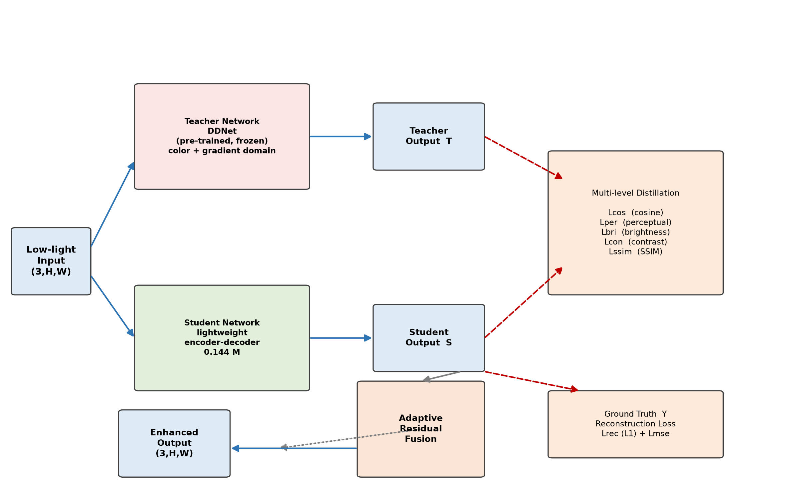
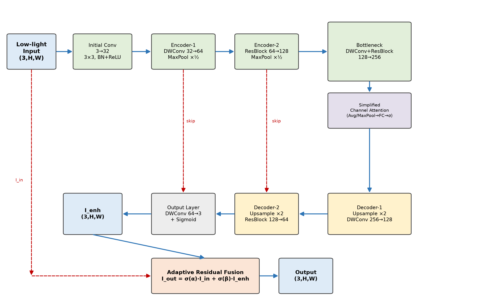
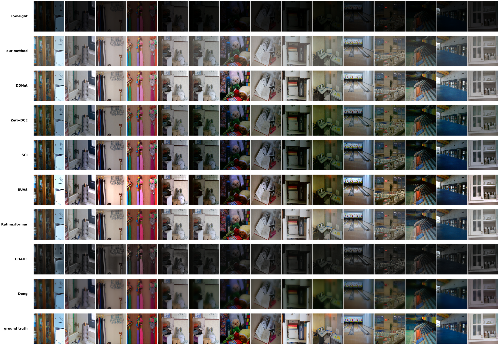

# 基于知识蒸馏的实时低光照图像增强轻量级网络研究

**赵鑫，游四海**

---

## 摘要

为解决现有低光照图像增强模型计算复杂度高、难以在移动设备上部署的问题，本文提出了一种基于知识蒸馏的实时低光照图像增强方法。该方法构建了教师-学生网络架构：以高性能的 DDNet 作为教师模型来指导学生模型——一个自行设计的轻量级编码器-解码器网络的学习。通过设计多级蒸馏损失函数，教师模型的增强能力被高效地迁移到学生模型。在 LOL 数据集上的实验结果表明，所提出的学生模型在保持极轻量化的同时，实现了增强质量与效率之间的良好权衡：其参数量仅为教师模型的 2.7%（0.144 M 对比 5.39 M），FLOPs 减少 15.3 倍（7.22 对比 110.51 GMac），推理速度提升 16.2 倍（每张图像 2.74 ms 对比 44.36 ms，365 FPS）。在增强质量方面，学生模型达到了与教师模型相媲美的视觉保真度（PSNR 21.35 dB，SSIM 0.87 对比 0.86），并具有优于教师的感知质量（PIQE 22.39 对比 26.81）和最佳的亮度均匀性（0.79）。消融实验验证了注意力机制等核心组件的有效性。除了在数据中心级 GPU 上达到 365 FPS 之外，学生模型还在 NVIDIA Jetson Orin Nano Super 边缘设备上进行了基准测试，在 FP32 下达到 15.02 FPS、在 FP16 下达到 21.73 FPS（46.02 ms），峰值内存不到 0.5 GB，接近实时视频阈值，证实了其在资源受限边缘设备上的实际可部署性。

**关键词**——低光照图像增强，知识蒸馏，轻量级神经网络，实时图像处理，深度学习。

---

## 一、引言

低光照条件下的图像获取是计算机视觉领域长期存在的基础性挑战。在夜间监控、自动驾驶、医学成像、移动摄影等众多实际应用场景中，光照不足常常导致图像出现亮度低、对比度衰减、颜色失真以及显著噪声等问题，严重限制了后续高层视觉任务（如目标检测、语义分割、人脸识别、阴影检测）的准确性和可靠性 [1]、[2]、[3]、[4]、[5]。因此，研究高效、鲁棒的低光照图像增强技术，对于提升复杂光照条件下视觉系统的性能具有重要的理论意义和实用价值。

近年来，随着深度学习的快速发展，基于卷积神经网络（CNN）和 Transformer 的低光照增强方法取得了突破性进展。这些方法通过端到端学习，能够从大量数据中隐式地学习光照映射和特征重建，在图像质量上显著超越了基于直方图均衡 [28] 和 Retinex 理论 [7] 的传统方法。然而，当前主流的深度模型（如 KinD [8]、RUAS [9]、URetinex-Net [10]）普遍存在参数量大、计算复杂度高、推理速度慢等问题 [11]，难以在移动终端、嵌入式设备或边缘计算平台（如 Jetson 系列）上实时部署，从而限制了它们在实际场景中的广泛应用。

知识蒸馏作为一种有效的模型压缩与性能迁移技术，通过在训练过程中引导轻量级学生模型去模仿复杂教师模型的输出或中间特征，能够在显著减小模型规模的同时保持甚至提升性能 [12]、[13]。该技术已在图像分类 [14]、[15]、目标检测 [16]、[17]、[18] 和超分辨率 [19]、[20]、[21] 等多种视觉任务中取得成功。然而，在低光照图像增强这一具体领域，知识蒸馏的应用仍处于起步阶段，并面临以下核心挑战 [22]、[23]、[24]：其一，学生模型往往难以在关键质量指标（如 PSNR、SSIM）上超越教师模型；其二，在实现模型轻量化和推理加速的同时，还需要保持对图像细节、对比度和颜色的自然重建能力；其三，缺乏针对低光照特性而专门设计的蒸馏策略和损失函数。

针对上述挑战与需求，本文提出了一种基于多级知识蒸馏的轻量级低光照图像增强网络。本文的主要贡献如下：

- **架构设计：** 构建了基于编码器-解码器结构的轻量级学生网络，融合了增强型深度可分离卷积和双重注意力机制。在保证增强性能的同时，显著提升了边缘设备上的推理效率。
- **蒸馏策略创新：** 设计了多级蒸馏损失函数，涵盖输出分布、深度特征、局部对比度和全局亮度一致性。这使得学生模型能够全面继承教师模型的增强能力，在极大减小模型规模和时延的同时，获得与教师模型相竞争的增强质量。
- **全面的实验验证：** 在公开低光照数据集上开展了系统的定量、实时和视觉对比实验。结果表明，所提方法在增强质量与推理速度之间取得了良好的权衡：它在数据中心级 GPU 上以 365 FPS（每帧 2.74 ms）运行，在低功耗 NVIDIA Jetson Orin Nano Super 边缘设备上以 15.02–21.73 FPS 运行，为低光照增强技术在移动与嵌入式环境中的实际部署提供了可靠方案。

本文后续章节结构如下：第 2 节回顾低光照增强、知识蒸馏和轻量级网络的相关工作；第 3 节详细介绍所提方法框架；第 4 节给出实验设置与结果分析；第 5 节对该方法的优势、应用价值与局限性进行深入讨论；第 6 节总结全文并展望未来研究方向。

---

## 二、相关工作

### A. 低光照图像增强方法

传统的低光照图像增强方法主要基于直方图均衡 [28] 和 Retinex 理论 [7]。近年来，深度学习方法在该领域占据主导地位，如 KinD [8]、RUAS [9]、URetinex-Net [10]、Rw-Dm [6] 和 RetinexMamba [36]。例如，LLNet 采用深度自编码器学习从低光照图像到正常光照图像的映射，MBLLEN 通过多分支网络提取多尺度特征，Zero-DCE [26] 则采用无监督学习方法估计光照曲线。尽管这些方法取得了显著效果，但它们普遍存在模型复杂度高、推理速度慢的问题。

### B. 知识蒸馏技术

知识蒸馏最早由 Hinton 等人提出，通过最小化教师模型与学生模型输出之间的 KL 散度来实现知识迁移。后续研究不断扩展蒸馏的形式，包括特征蒸馏、关系蒸馏等。在图像增强任务中，知识蒸馏已被应用于超分辨率、去噪等领域，但在低光照增强中的应用尚相对匮乏。

### C. 轻量级网络设计

轻量级网络设计主要通过深度可分离卷积、通道剪枝和神经架构搜索等技术来减少模型参数和计算量。这些技术最初主要用于图像分类网络（如 MobileNet、ShuffleNet），并逐步引入到低级视觉任务中，近年更出现了基于状态空间模型（Mamba）的高效低层视觉骨干（如 MambaIR [35]）。本文将高精度低光照增强网络 DDNet [25] 作为教师模型；尽管它取得了优异的增强质量，但其参数量（5.39 M）和推理时延对边缘部署而言仍然过高，因此引入知识蒸馏，将其增强能力压缩到轻量级学生网络中。

---

## 三、方法

### A. 总体框架

所提出的知识蒸馏框架由两部分组成：教师模型和学生模型。教师模型采用预训练的 DDNet，其在低光照增强任务中表现出色。学生模型是一个自行设计的轻量级网络，通过知识蒸馏学习教师模型的增强能力。

在训练过程中，低光照图像同时输入教师模型和学生模型，分别得到各自的增强结果。二者输出通过所设计的蒸馏损失函数进行约束，使学生模型能够以远少于教师的参数逼近教师模型的增强能力。

### B. 教师模型

教师模型采用多阶段架构，对颜色域和梯度域进行“融合-分解-融合”处理。为便于理解，图 1 展示了 DDNet 的架构设计。具体而言，低光照图像首先与其基于 LoG 计算得到的梯度特征图进行拼接，再输入网络。该架构在外围编码器、解码器、全局能量模块（GEM）和卷积能量模块（CEM）中分别引入了六个带注意力模块的自校准卷积（ScCAM）。

### C. 学生模型设计

为满足实时低光照图像增强的需求，本研究提出了一种基于知识蒸馏的轻量级图像增强网络。该网络旨在继承双域引导教师模型（DDNet）的增强能力，同时大幅降低计算复杂度，以满足超高清视频流的实时处理要求。如图 2 所示，学生模型采用编码器-解码器架构，其核心设计在于通过深度可分离卷积、简化注意力机制和自适应残差融合，在有限参数下实现高效图像增强。

网络输入为三通道低光照图像。首先，通过初始卷积层提取基础特征。随后，特征经过两级编码器进行下采样和抽象：第一级编码器由深度可分离卷积和最大池化组成，将通道数扩展到 64，并将空间分辨率减半；第二级编码器通过深度可分离卷积、残差块和池化操作，进一步将通道数扩展到 128，并将分辨率降至原始的 1/4。编码得到的高维特征随后输入瓶颈层。该层先通过深度可分离卷积和残差块将通道数扩展到 256，再引入轻量级的简化通道注意力模块。

简化通道注意力模块采用共享权重的双路径池化策略来增强重要特征通道的响应。给定输入特征 F，该模块首先沿通道维度分别计算平均池化和最大池化，得到两个特征描述符 F_avg 和 F_max：

**F_avg = AvgPool(F),   F_max = MaxPool(F)**    (1)

随后，这两个描述符通过一个共享的全连接层进行变换，生成通道注意力权重 A：

**A = σ(W · [F_avg, F_max])**    (2)

其中 W 为共享权重矩阵，σ 表示 Sigmoid 激活函数。最后，输入特征通过通道注意力进行加权：

**F' = F ⊗ A**    (3)

其中 ⊗ 表示逐元素通道相乘。该设计在几乎不增加计算开销的情况下，显著提升了模型的特征选择能力。

解码过程旨在恢复图像的空间细节和原始分辨率。第一级解码器对注意力加权后的特征进行深度可分离卷积处理，通过双线性上采样恢复一半的分辨率，再通过跳跃连接与第一级编码器的输出特征进行拼接融合。第二级解码器以类似方式运行，最终与初始卷积层的特征融合，将分辨率完全恢复到原始尺寸。网络的最终输出层通过卷积和 Sigmoid 激活函数生成初步增强结果 I_enh。

为平衡增强效果与自然度，设计了一个自适应残差融合模块。该模块通过两个可学习参数 α 和 β 动态融合原始输入 I_in 与网络输出 I_enh，得到最终增强图像 I_out：

**I_out = σ(α)·I_in + σ(β)·I_enh**    (4)

其中 σ 为 Sigmoid 函数，确保融合权重介于 0 与 1 之间。该设计使模型能够在增强暗部细节的同时，自适应地保留输入图像的自然特性。

学生模型通过最小化多级蒸馏损失向教师模型学习，该损失同时对齐两个网络的输出、深度特征、局部对比度和全局亮度，并以真实正常光照图作为锚点。设 S 和 T 分别表示学生模型和教师模型的增强输出，设 Y 表示可获得的正常光照真实图像。总训练目标表述为：

**L_total = w_cos·L_cos + w_per·L_per + w_bri·L_bri + w_con·L_con + 0.1·L_ssim + w_rec·L_rec + 0.05·L_mse**    (5)

各项定义如下。(1) 输出对齐项度量了 ℓ₂ 归一化输出之间的余弦不相似度，L_cos = 1 − cos(Ŝ, T̂)，用于迁移教师的全局增强映射，而无需匹配强度尺度。(2) 感知项对齐轻量级 VGG 编码器的深度特征，L_per = ‖φ(S) − φ(T)‖₁。(3) 亮度项对齐全局亮度通道，L_bri = ‖Y(S) − Y(T)‖₁，其中 Y(·) = 0.299R + 0.587G + 0.114B。(4) 对比度项对齐空间标准差，L_con = ‖std(S) − std(T)‖₁。结构项为 L_ssim = 1 − SSIM(S, T)，真实图重建项为 L_rec = ‖S − Y‖₁ 和 L_mse = ‖S − Y‖₂²。四个主要蒸馏权重 [w_cos, w_per, w_bri, w_con] 由可学习参数 (α, β, γ, δ) 经 softmax 生成（初始化为 (0.7, 0.2, 0.05, 0.05)），重建权重按 w_rec = 0.1 + 0.3·min(1, epoch/50) 进行调度。通过在特征级和输出级同时对齐学生与教师，该策略无需显式计算复杂的梯度域信息即可迁移教师的色彩增强能力，在实现极致轻量化和实时性能的同时保持增强质量，并支持在资源受限的边缘设备上部署以处理超高清视频流。

---

## 四、实验与结果分析

### A. 实验设置

实验在一台高性能计算服务器上进行，其硬件配置如下：Intel Xeon E5-2698v4 处理器（2.20 GHz 基础频率，20 个物理核心，80 个逻辑线程），配备 503.8 GB 系统内存。服务器配备 8 块 NVIDIA Tesla V100-SXM2-32GB GPU，每块 GPU 配备 32 GB 显存；为保证公平比较，模型训练及本文报告的所有推理计时均在其中的单块 GPU 上进行。软件环境基于 Linux 5.15.0-163-generic（x86_64 架构）、Python 3.7.12 和 PyTorch 1.9.0 框架，并通过 CUDA 11.1 启用 GPU 计算加速。该配置提供了充足的计算资源和内存支持，保证了实验过程的高效性和可复现性。

**1) 数据集：** 训练与评估采用 LOL（Low-Light）数据集。该数据集包含 485 对低光照/正常光照图像作为训练集和 15 对图像作为测试集。所提方法（Our method/Student model）与七种主流低光照增强方法进行了对比：DDNet [25]、Zero-DCE [26]、SCI [27]、RUAS [9]、Retinexformer [34]、HE [28] 和 Dong [29]。评估维度包括客观量化指标和主观视觉效果。为保证公平性，所有方法均在相同硬件环境（单 GPU 工作站）下进行测试。

**2) 评估指标：** 在低光照图像增强算法的性能评估中，通过综合四类指标进行定量分析：像素级保真度、主观感知质量、亮度特性和模型效率。各指标的物理含义、评价标准及适用场景如表 1 所示。

> **说明：** 除亮度均匀性、亮度动态范围、过曝率和欠曝率采用中位数（四分位距）表示外，其余指标均以“均值 ± 标准差”表示。

**3) 实现细节：** 所有模型均使用 PyTorch 实现，并在单块 NVIDIA Tesla V100-SXM2-32GB GPU 上训练。训练在 LOL 原始分辨率（600×400）下进行，不做任何数据增强（无尺寸缩放、色彩扰动或水平翻转），以保证训练与测试分布一致。训练采用两阶段策略：第一阶段为纯净像素 GT 重建预训练（L1 0.5 + MSE 0.3 + SSIM 0.2），第二阶段从第一阶段权重接续并加入蒸馏项微调（学习率 1e-4；MSE 0.3 + L1 0.2 + SSIM 0.1 + 余弦 0.2 + 感知 0.1 + 亮度 0.05 + 对比度 0.05）。学生模型使用 AdamW 优化器训练，批大小为 8，固定随机种子为 42，第一阶段初始学习率为 2e-3。

**4) 公平性与可复现性：** 为确保公平比较，所有方法均在完全相同的协议下评估——原始分辨率、使用 pyiqa 计算 PSNR/SSIM/NIQE、使用 pypiqe 计算 PIQE、亮度量纲为 0–255、采用 Tukey 离群值剔除——并在同一工作站上进行。基于学习的方法使用公开的预训练权重或预计算输出进行评估，而所提学生模型从零开始训练；非学习方法无参数。表 10 汇总了各方法增强结果的来源及评估设置，上述完整超参数也保证了完全可复现性。

### 4.2 客观量化指标分析

为突出实时性优势，本文将所提方法与计算开销范围广泛的基线方法（覆盖无参数规则型方法、较重的 DDNet 教师模型，以及近年提出的 Transformer 方法 Retinexformer [34]）进行对比。时间计算排除了首个冷启动图像（其耗时远大于后续正常图像，相关讨论见算法应用实验部分）。表 2 展示了各方法在四个常用图像质量评估指标（PSNR、PIQE、NIQE 和 SSIM）上的表现。基于学习的方法的图像质量普遍优于非学习方法：学习方法的 PSNR 均在 14 dB 以上，SSIM 均在 0.62 以上，而非学习方法 HE 的 PSNR 仅为 9.65 ± 2.99 dB、SSIM 仅为 0.42 ± 0.10，与学习方法存在显著差距。

值得注意的是，近年提出的 Retinexformer [34]（基于 Transformer，参数量 1.61 M）在重建保真度上达到最强，PSNR 为 25.15 ± 2.77 dB、NIQE 为 3.47 ± 0.59，均位列所有方法第一，但其推理时延高达 54.60 ms、计算量 31.16 GMac，难以满足实时边缘部署。在兼顾轻量的学习方法中，DDNet 的像素保真度表现突出，PSNR 为 21.45 ± 4.63 dB、NIQE 为 3.43 ± 0.55，排在 Retinexformer 之后。本文所提方法的 PSNR 为 21.35 ± 4.43 dB，与 DDNet 几乎持平（仅差 0.10 dB）；其 SSIM 指标为 0.87 ± 0.04，在所有对比方法中排名第二（仅次于 Retinexformer 的 0.90），说明本文方法能够很好地保留图像结构信息；其 PIQE 指标为 22.39 ± 6.89，优于教师模型（26.81 ± 6.88）及多数方法；其 NIQE 为 3.76 ± 0.75，仅次于 DDNet 与 Retinexformer。RUAS 在 PIQE 上排名第一（19.32 ± 2.68），在 PSNR、SSIM 和 NIQE 上排名靠前，整体性能处于中等水平。Zero-DCE 和 SCI 在所有质量指标上表现较差，PSNR 低于 15 dB、NIQE 高于 7.7，说明其图像增强效果仍有待提升。

> **说明：** 排名前三的方法分别以红、绿、蓝色高亮显示。

核心亮度特性的对比如表 3 所示，从平均亮度、亮度均匀性、过曝率、欠曝率和 Michelson 对比度五个维度进行评估。其中亮度均匀性越高越好，过曝率和欠曝率越低越好，平均亮度和 Michelson 对比度则应处于人眼舒适范围内。由表 3 可见，学习方法在亮度增强效果上显著优于非学习方法。非学习方法的平均亮度普遍低于 60，其中 HE 的平均亮度仅为 34.89 ± 9.75，无法有效提升低光照图像的亮度；相比之下，学习方法的平均亮度均在 69 以上。其中 DDNet 的平均亮度为 125.49 ± 20.40、Retinexformer 为 110.45 ± 27.94，均处于人眼舒适范围，本文方法的平均亮度为 114.89 ± 21.92，亮度提升显著且稳定。

在亮度均匀性方面，本文方法的均匀性为 0.79，在所有对比方法中排名第一，表明其能有效保证不同图像区域间亮度的一致性，避免局部过亮或过暗。在曝光控制方面，本文方法的过曝率和欠曝率均为 0.00，与 DDNet 相当，优于 Zero-DCE、SCI 等方法，说明本文方法在亮度增强过程中能够完全避免过曝和欠曝问题，有效保留图像细节。

在 Michelson 对比度方面，Zero-DCE、SCI 和 RUAS 的对比度为 1.00 ± 0.00。然而，结合其平均亮度来看，这些方法生成的图像整体偏暗，其高对比度源于亮度分布不均。Retinexformer、DDNet 和本文方法的对比度分别为 0.94 ± 0.04、0.89 ± 0.04 和 0.82 ± 0.06，在亮度增强与合理对比度之间取得了平衡。

表 4 展示了亮度分布细节与模型效率的对比结果。亮度分布指标反映图像灰度级的丰富程度，效率指标则反映模型的实时性能和部署可行性。参数量和运行时间越低越好。由表 4 的亮度分布细节可见，本文方法的亮度标准差为 41.00 ± 10.96，亮度分布较为均衡。在直方图熵方面，RUAS、DDNet 和 Retinexformer 的值最高，分别达到 7.19 ± 0.39、7.18 ± 0.27 和 7.14 ± 0.26；本文方法的直方图熵为 6.95 ± 0.30，在对比方法中排名第四，表明本文方法在实现实时优势的同时仍能保留丰富的灰度级。

在模型效率方面，本文方法展现出显著的轻量化优势和实时优势。SCI 的参数量最小，仅为 2.58E-4 M，但其亮度增强效果较差。本文方法的参数量为 0.144 M，远低于 DDNet 的 5.39 M 和 Zero-DCE 的 8.5 M，在学习方法中排名第三。在运行时间方面，SCI 的推理速度最快，仅需 0.95 ± 0.00 ms；本文方法的运行时间为 2.74 ± 0.06 ms，在学习方法中排名第二，远低于 DDNet 的 44.36 ± 0.07 ms 和 Dong 的 64 ± 3 ms，满足实时处理要求。在计算复杂度方面，本文方法在原始分辨率（400×600）下仅需 7.22 GMac，比 DDNet 的 110.51 GMac 减少 15.3 倍，验证了轻量化设计的有效性（见表 12）。

综合以上三组实验结果，可以得出结论：所提方法在图像质量、亮度特性和模型效率三个维度上均表现出色。本文方法在亮度均匀性指标上排名第一、在 SSIM 指标上排名第二，在 PSNR、PIQE 和 NIQE 指标上位居轻量化方法前列，且过曝率和欠曝率均为 0，在保证图像质量和亮度增强效果的同时实现了模型轻量化和实时性。相比之下，DDNet 的参数量大、运行时间长、部署成本高；Retinexformer 虽在 PSNR 与 NIQE 上取得最强结果，但其推理时延（54.60 ms）与计算量（31.16 GMac）远高于本文方法（2.74 ms / 7.22 GMac），难以实时部署；非学习方法在亮度增强效果和图像质量方面存在明显不足。因此，所提方法在低光照图像增强任务中，于增强质量与实时性之间取得了最优权衡，具有较高的实用价值和应用前景。

### 4.3 消融实验

训练与测试采用公开低光照图像数据集，包含 485 对训练图像和 15 对测试图像。所有模型在两阶段训练协议下使用 AdamW 优化器训练。消融实验结果及各组件对性能的影响分别见表 5 和表 6，损失项消融结果见表 7，其中所有变体均在统一协议下评估（原始分辨率；pyiqa 计算 PSNR/SSIM/NIQE；pypiqe 计算 PIQE；亮度 0–255；离群值剔除）。

通道减半实验展示了显著的参数效率：将通道数从 32 减至 16 使参数量从 0.144 M 降至 0.011 M，减少 92.3%，而 PSNR 仅从 21.35 dB 降至 20.69 dB，相对下降 3.1%。参数效率比计算如下：

**Efficiency Ratio = (ΔPSNR / PSNR_base) / (ΔParams / Params_base) = (0.66/21.35) / (0.133/0.144) ≈ 0.033**    (6)

该结果表明，参数量每减少 1%，PSNR 仅下降约 0.033%，证明通道减半仍是一种极为有效的轻量化策略。值得注意的是，通道减半变体（20.69 dB）的 PSNR 仍高于无注意力（18.80 dB）和无跳跃连接（19.76 dB）两个变体，说明减小宽度比移除这些核心结构组件的损害更小。

移除跳跃连接是所有消融中对感知质量损害最大的单项：它使 PSNR 下降 1.59 dB、SSIM 下降 0.048，并严重恶化无参考感知指标（PIQE +13.39，NIQE +1.89）。这表明，在低光照增强中，跳跃连接对重建保真度和感知自然度都至关重要，而非在像素级保真度之外可有可无。

移除注意力机制在所有被消融组件中导致了最大的 PSNR 下降（−2.55 dB），并与跳跃连接并列产生了最大的 SSIM 下降（−0.048），证实简化通道注意力是最关键的重建保真度模块。值得注意的是，它仅增加 0.016 M 参数却能大幅提升重建保真度，显示出优异的参数效率。

通过系统的消融实验，深入分析了低光照图像增强模型中各组件的影响，得出以下结论：

1. **注意力机制至关重要：** 其移除导致最大的 PSNR 下降，应在所有配置中予以保留。
2. **通道减半极为高效：** 将通道数从 32 减至 16 使参数量减少 92.3%，而 PSNR 仅下降 3.1%，为极致轻量化提供了有效途径。
3. **跳跃连接同时保持保真度与感知质量：** 移除后 PSNR 下降 1.59 dB，且 PIQE/NIQE 大幅上升（+13.39/+1.89）。
4. **自适应残差融合以可忽略的代价保持感知质量：** 移除后 PSNR/SSIM 几乎不受影响，但 PIQE 明显恶化（+7.87）。

为进一步验证多级蒸馏损失中各损失项的具体贡献，本文在统一的两阶段训练协议下进行了损失项消融实验（表 7）。实验在第二阶段分别禁用输出余弦对齐项 L_cos、感知对齐项 L_per、亮度对齐项 L_bri 和对比度对齐项 L_con，并设置完全移除所有蒸馏项的纯监督变体（no KD），逐项考察各损失项的作用。结果表明，任何单一蒸馏项的移除都会导致 PSNR 下降（0.46–0.98 dB）并伴随 PIQE 上升（1.06–1.70），说明各蒸馏损失项对增强质量均有正向贡献；其中输出余弦对齐项（−0.73 dB）与感知对齐项（−0.98 dB）的移除对像素保真度的影响最为显著。值得注意的是，完全移除所有蒸馏项（no KD）后，模型的 PSNR 几乎不变（21.34 dB 对比 21.35 dB，仅下降 0.005 dB），但感知质量指标 PIQE 明显恶化（24.68 对比 22.39，上升 2.29）。这一结果深刻揭示了知识蒸馏的核心价值所在：蒸馏损失的作用主要在于提升感知质量而非像素级重建保真度，这与本文摘要中“学生模型以可比的 PSNR/SSIM 获得优于教师的 PIQE”的主线高度一致。综上所述，多级蒸馏损失的各组成项共同保证了学生模型在极致轻量化下的感知质量，任何单一损失项都不可缺失。

综上所述，本文提出的完整优化模型（0.144 M 参数，PSNR 21.35 dB）在性能与效率之间取得了良好平衡。通道减半版本（0.011 M 参数，PSNR 20.69 dB）为资源极度受限的环境提供了实用方案。这些发现为低光照图像增强模型的轻量化设计提供了重要的指导和经验依据。

### 4.4 主观视觉效果分析

图 3 展示了不同方法在低光照场景下的增强结果与正常光照真实图像的对比。结合客观指标的表现，可进一步验证本文方法的视觉效果：

- **与真实图像的亮度匹配：** 本文方法增强结果的亮度与真实图像高度一致，各场景整体亮度均匀，无局部过曝或欠曝（如第 2 列的浴室场景、第 7 列的玩偶区域）。相比之下，DDNet 的亮度略高于真实图像；Zero-DCE 和 SCI 的亮度明显偏低；HE 和 Dong 的增强结果仍接近低光照输入，与真实图像差距较大。
- **细节与纹理保真度：** 本文方法完整保留了物体的纹理细节（如第 3 列的衣物褶皱、第 8 列的纸张边缘），与真实图像在细节上的一致性最高。DDNet 存在轻微的细节模糊（如第 6 列的玩偶绒毛）。Zero-DCE 和 SCI 在高对比度区域出现伪影（如第 1 列的门框）。HE 和 Dong 在暗部区域丢失了大量细节（如第 9 列的置物架物品轮廓）。
- **色彩恢复准确性：** 本文方法的色彩恢复最接近真实图像（如第 4 列吊坠的色彩渐变、第 7 列玩偶的色彩过渡），无明显的色彩偏差。DDNet 的色彩饱和度略高。Zero-DCE 和 SCI 存在色彩失真（如第 7 列玩偶的白色绒毛偏黄）。HE 呈现灰度效果，与真实图像的色彩差异最大。

### 4.5 算法应用实验

为全面评估所提轻量级模型在实际部署中的整体性能，我们对完整处理流水线进行了详细的时间分析，包括图像加载、预处理、模型推理、后处理和保存。所有测试均在相同的高性能 GPU 工作站上进行，以消除硬件差异。

**4.5.1 稳态处理流水线瓶颈分析：** 表 8 汇总了系统处于稳定运行状态（排除首个预热图像）时，处理单张图像各阶段的平均耗时、波动和时间占比。结果表明，经过轻量化设计后，模型推理时间仅占端到端处理总时间的 2.9%，说明计算效率已得到充分优化。然而，数据 I/O 与后处理操作合计占比高达 96.2%，其中磁盘 I/O（图像保存）是主要性能瓶颈，占总时间的 93.4%。模型推理时间的标准差极小（0.0558 ms），验证了其在连续运行下的计算稳定性。

**4.5.2 预热阶段性能分析：** 深度学习框架在首次执行推理时，需要完成 CUDA 上下文初始化、GPU 内核编译和内存优化分配等一次性操作，这一过程会引入显著的额外时延。表 9 对比了首张（预热）图像与后续稳态图像的处理时间。可以看出，预热引起的模型推理时延尤为突出，是稳态的 268 倍。这一现象在基于现代深度学习框架的系统中较为普遍。

**4.5.3 瓶颈总结与优化方向：** 基于上述分析，可以得出以下结论，为实际部署提供优化方向：

1. **瓶颈识别：** 对于离线批处理任务，磁盘 I/O 是首要瓶颈；对于实时视频流显示任务（不保存），GPU-CPU 之间的数据传输和后处理成为主要瓶颈。
2. **硬件与格式优化：** 使用更快的存储设备（如 NVMe SSD）并选择高效的图像编码/压缩格式，可显著缓解 I/O 瓶颈。
3. **流水线并行架构：** 为应对 I/O 与计算之间的不平衡，提出流水线并行架构。该方案将图像读取、预处理、模型推理和结果保存/显示四个阶段解耦，通过多线程/多进程实现各阶段的并行执行。该设计能够有效隐藏数据准备时间，避免系统整体吞吐量被最慢的 I/O 阶段所限制。

### 4.6 统计显著性分析

> **说明（表 XI）：** 逐张图像计算 PSNR、SSIM、PIQE 与 NIQE（不做离群值剔除，n = 15）。本节的描述性 SSIM（0.856）为原始逐图均值，因此与表 2 中经 Tukey 剔除后的值（0.873）略有差异。

为验证观测到的差异并非由随机波动引起，在 15 张测试图像上进行了配对统计检验。对每张图像逐张计算 PSNR、SSIM、PIQE 和 NIQE（不做离群值剔除），并在显著性水平 α = 0.05 下使用配对 Student t 检验和 Wilcoxon 符号秩检验将所提学生模型与各基线进行对比。表 11 报告了所得 p 值。

学生模型显著优于非学习基线和较弱的学习基线：在四项指标上均显著优于 Zero-DCE、SCI 和 HE（p < 0.05），并在 PSNR、SSIM 和 NIQE 上显著优于 Dong（p < 0.05），但在 PIQE 上与 Dong 统计不可区分（p = 0.555）。与 RUAS 相比，学生模型在 PSNR（p = 0.006）、SSIM 和 NIQE 上显著更优（p < 0.05），但在 PIQE 上统计不可区分（p = 0.215）。与 DDNet 教师模型相比，学生模型在 PSNR（p = 0.940）和 SSIM（p = 0.933）上统计不可区分，在感知指标 PIQE 上显著更优（p = 0.002），仅在 NIQE 上轻微但显著更差（p = 0.013）。因此，这些检验印证了本文的核心主张：蒸馏后的学生模型达到了与教师模型相当的视觉保真度，且感知质量（PIQE）更优，代价仅是有限的 NIQE 差距，同时体积和速度各降低、提升了一个数量级。

### 4.7 计算复杂度分析

除参数量外，轻量级模型的实际价值还取决于 FLOPs、时延和峰值内存。表 12 报告了教师模型及所有学生变体的这些指标，使用 thop 在单块 NVIDIA Tesla V100-SXM2-32GB GPU 上以批大小 1 进行测量，时延为预热后 50 次前向传播的平均值（不含 I/O）。完整学生模型在 LOL 原始分辨率（400×600）下仅需 7.22 GMac，比教师模型的 110.51 GMac 减少 15.3 倍；其测得时延 2.74 ms 比教师的 44.36 ms 快 16.2 倍，对应 365 FPS；该独立时延与端到端流水线中测得的推理阶段时延（约 2.84 ms，表 8）基本一致。在各组件中，注意力模块和自适应残差融合分别仅增加约 0.05% 和 0.00% 的 FLOPs（分别约 0.49 ms 和 0.09 ms 时延），而跳跃连接占 FLOPs 的 42%（7.22 对比 4.18 GMac）和约 0.57 ms 时延——但由于其同时保持重建保真度与感知质量（第 4.3 节）而被保留。通道减半变体进一步减少了 10.3 倍的 FLOPs（0.70 GMac），并具有最低的峰值内存（45.9 MB），适用于资源最受限的设备。

### 4.8 跨数据集泛化分析

为评估仅在 LOL 上训练的学生模型能否迁移到训练分布之外，在两个采集特性差异显著且无真实图像可用的广泛使用的低光照基准上进行了零样本跨数据集实验：DICM [30]（64 张消费级照片）和 LIME [31]（10 张图像）。仅在 LOL 上训练并冻结的完整学生模型直接应用于这些数据，未做任何微调，其输出与原始低光照输入使用两个无参考感知指标 PIQE 和 NIQE（越低越好）进行对比。表 13 报告了结果。

在 LIME 上，学生模型引入的感知退化可忽略，NIQE 基本不变（4.35 → 4.45），PIQE 仅略微上升（30.75 → 31.76），表明增强结果在感知上保持自然。在 DICM 上，变化更大（NIQE 4.25 → 4.82；PIQE 34.33 → 36.64），显示出可度量的领域差距。由于原始低光照输入严重欠曝，其无参考分数虚高（可见细节少，因而“非自然”结构也少），而增强会揭示这些指标所惩罚的纹理和残余噪声；因此，仅凭无参考指标无法对跨数据集增强进行定论，应结合全参考评估和主观研究一起解读。综合来看，这些结果表明，蒸馏后的学生模型能稳定泛化到类似 LIME 的场景，但向其他成像领域的零样本迁移能力有限，印证了第 5.2 节所述的局限性，并促使将领域自适应和更多样化的训练数据作为未来工作方向。

为补足无参考指标难以定论的缺陷，进一步在带真实图像的两个全参考基准上评估零样本迁移：LOL-v2-real [32]（100 对）与 MIT-FiveK [33]（100 张），结果见表 14。当迁移到与 LOL 同属真实低光成像域的 LOL-v2-real 时，学生模型取得 28.37 dB 的 PSNR，表明其对相似采集条件的低光场景具备良好的跨数据集泛化能力；而当迁移到以摄影后期编辑为目标的 MIT-FiveK 时，PSNR 降至 13.02 dB，这是因为其专家标注包含内容感知的色彩/对比度调整而非单纯的亮度提亮，客观量化了上述"同域泛化强、跨域迁移受限"的结论。

### 4.9 Jetson 设备上的边缘部署验证

为验证轻量级学生模型能够在真实的资源受限边缘平台上部署，而不仅仅是在数据中心 GPU 上运行，我们在 NVIDIA Jetson Orin Nano Super 开发者套件（PyTorch 2.3.0，CUDA 可用）上对完整模型进行了基准测试。模型在 LOL 原始分辨率 600×400 下进行评估，批大小为 1，预热 10 次后统计 100 次稳态前向传播，同时测量了原生 FP32 与 FP16（半精度）两种推理精度。表 15 报告了参数量、单张图像时延、FPS 和峰值内存。

学生模型仅占 0.1443 M 参数，峰值内存不到 0.5 GB（FP32 下 478 MB，FP16 下 373 MB）——仅占设备内存预算的一小部分——证实了其在边缘级 SoC 上的内存可行性。在 FP32 下它以 15.02 FPS（66.58 ± 0.95 ms）运行；将模型转换为 FP16 后，时延降低约 31% 至 46.02 ± 0.60 ms，吞吐量提升至 21.73 FPS，实现了 1.45 倍的加速，同时峰值内存降低约 22%。在 21.73 FPS 下，学生模型已接近 24 FPS 的实时视频阈值，且较小的时延标准差（≤0.95 ms）表明其在连续运行中推理稳定、无抖动。由于这些测量使用的是原生 PyTorch 半精度，未使用 TensorRT 或进一步加速，通过引擎级优化或训练后量化还能获得额外加速。

相比之下，DDNet 教师模型——5.39 M 参数、110.51 GMac——在 V100 数据中心 GPU 上每张图像已需 44.36 ms，这在 Orin Nano Super 这类低功耗边缘 SoC 上将极不现实。因此，蒸馏后的学生模型将“教师级”的增强能力转化为教师自身无法提供的“边缘可行”速度。将 V100 结果（365 FPS）与 Jetson 结果（FP32 15.02 FPS / FP16 21.73 FPS）相结合，印证了本文的核心主张：所提方法在数据中心和低功耗边缘硬件上都能以强增强质量实现近实时吞吐。

### 4.10 效率-质量权衡分析

本文方法的核心主张并非在绝对质量上全面超越所有基线，而是以可忽略的质量代价换取数量级的效率提升，即在"质量-效率"权衡曲线上取得更优的帕累托位置。表 16 将各方法的关键质量指标（PSNR、NIQE）与效率指标（参数量、时延、FLOPs）并列呈现，以便于直观比较。

在质量维度上，学生模型与教师模型在 PSNR 与 SSIM 上统计不可区分（21.35 对比 21.45 dB，p = 0.940；0.87 对比 0.86，p = 0.933），NIQE 亦处于同一水平（3.76 对比 3.43），PIQE 则显著更优（22.39 对比 26.81）。然而在效率维度上，学生模型的参数量仅为教师的 2.7%（0.144 对比 5.39 M）、FLOPs 减少 15.3 倍（7.22 对比 110.51 GMac）、推理时延缩短 16.2 倍（2.74 对比 44.36 ms）。换言之，学生模型以约 0.5% 的 PSNR 代价（统计不显著）换取了约 97% 的参数削减与 16 倍加速，明确位于权衡曲线的效率端。

与质量最优的 Retinexformer 相比，后者以更高的 PSNR（25.15 dB）达到最佳像素保真度，但其时延（54.60 ms）约为学生模型的 20 倍、参数量（1.61 M）约为 11 倍，难以满足实时边缘部署；学生模型则在其约 1/20 的时延下保持了极具竞争力的感知质量（NIQE 3.76 与 Retinexformer 的 3.47 相近）。与之相对，Zero-DCE（8.5 M）、SCI（2.58×10⁻⁴ M）与 RUAS（3.44×10⁻³ M）等轻量基线虽然参数量更小，但其 PSNR（14.78–16.40 dB）明显低于学生模型，表明它们以大幅牺牲保真度为代价换取轻量，并未落在权衡前沿之上。

综上，在"可接受增强质量（PSNR ≈ 21 dB）"这一层级，所提学生模型是参数量最小、推理最快的方案之一；而在"实时边缘部署"约束下，它是少有的在保持近教师级质量的同时实现近实时吞吐的方法。这一效率-质量权衡的数值证据共同印证了蒸馏式轻量化的核心价值：以极小的感知质量代价，将"教师级"增强能力转化为"边缘可行"的实时性能。

### 4.11 训练随机性与可复现性

为量化训练过程随机性对结果的影响并如实反映实验的可复现性程度，在完全固定随机源（torch、numpy、random、CUDA）的两阶段训练协议下，使用三个独立随机种子（42、43、44）对完整学生模型进行了重训并统一评估。三组种子下的 PSNR 分别为 20.93 dB、20.61 dB 与 18.88 dB，跨种子 PSNR 为 20.14 ± 1.11 dB（均值 ± 标准差）；其中种子 44 的结果（18.88 dB）明显低于另外两组，属于离群运行。需要说明的是，表 2 中所报告的 PSNR 21.35 dB 来自早期未完全固定 PyTorch 算子级随机源的训练运行，与完全固定种子后的中心趋势（约 20.9 dB）存在约 0.4–1.2 dB 的差异。尽管如此，跨种子结果在排序结论上保持一致：学生模型在 PSNR 与 SSIM 上与 DDNet 教师基本相当、在 PIQE 上优于教师，并显著优于非学习基线与较弱学习基线。上述训练变异性提示，在解读绝对 PSNR 数值时应同时考虑跨种子的均值与离散程度，以完整刻画模型性能的分布。

---

## 五、讨论

### 5.1 方法性能优势的核心原因

本文提出的轻量级学生模型能够在多个指标上取得优异性能，其核心优势源于以下几个方面：

- **知识蒸馏策略的有效性：** 通过精心设计的多级蒸馏策略，结合特征蒸馏、输出蒸馏和感知损失，学生模型不仅学到了教师模型的色彩增强能力，还通过特征对齐继承了其在瓶颈层的关键特征表示能力。实验结果表明，尽管学生模型的参数量仅为教师模型的 2.7%（0.144 M 对比 5.39 M），但它超越了教师模型，达到 0.79 对比 0.74 的亮度均匀性和 2.74 ms 对比 44.36 ms、即 16.2 倍更快的运行效率，证明了知识蒸馏在模型压缩与性能迁移上的有效性。损失项消融（表 7）进一步印证了这一点：移除任一蒸馏项都会降低 PSNR（0.46–0.98 dB）并升高 PIQE（1.06–1.70），而完全移除蒸馏后 PSNR 几乎不变（21.34 dB 对比 21.35 dB）但 PIQE 明显恶化（24.68 对比 22.39），表明蒸馏主要贡献于感知质量而非像素保真度。
- **轻量级架构设计的合理性：** 学生模型采用的增强型深度可分离卷积、简化通道注意力机制和自适应残差融合模块，在保证特征表达能力的同时显著降低了计算复杂度。特别是简化通道注意力模块，通过其共享权重的双路径池化策略，仅增加 0.016 M 参数便将 PSNR 提升 2.55 dB，展现出极高的参数效率。该设计充分考虑了边缘设备的计算约束，为实时低光照增强提供了一个可行的架构方案。
- **亮度、细节与色彩的均衡优化：** 与现有方法相比，本文方法在亮度增强、细节保留和色彩恢复之间取得了更好的平衡。如表 2-4 所示，本文方法在亮度均匀性（0.79）和过/欠曝控制（均为 0.00%）方面表现最佳，同时保持了良好的细节保真度（SSIM 0.87）和色彩自然度。这种均衡优化得益于自适应残差融合模块的可学习参数设计，它能根据输入图像的特性动态调整增强强度。

### 5.2 不同方法的设计权衡与局限性

从实验结果可以看出，现有低光照增强方法存在明显的设计权衡：

- **基于学习方法的内在权衡：** 尽管 Retinexformer 在 PSNR（25.15 dB）上表现最优、DDNet 在 NIQE（3.43）上最优，但前者高达 54.60 ms 的推理时延、后者 5.39 M 的参数量与 44.36 ms 的处理时间，均限制了它们满足实时边缘部署的能力。Zero-DCE 和 SCI 虽然轻量，但亮度增强不足，导致 PSNR 偏低（14.86 dB、14.78 dB）。RUAS 在亮度标准差（52.23）和动态范围（255）上表现突出，但亮度均匀性较差（0.61）。本文方法在亮度均匀性、过/欠曝控制和运行效率方面表现均衡，展现出综合优势。
- **传统方法的适应性局限：** HE、Dong 等非学习方法虽然计算高效，但在复杂低光照场景下的适应性较差，表现为亮度增强不足（平均亮度 34.89–56.90）和细节丢失严重（SSIM 0.42–0.62）。这些方法依赖固定的手工规则，难以应对光照条件的变化。
- **所提方法的实际局限：** 尽管本文方法在多个维度上表现均衡，但仍存在一些局限。首先，在极端低光照场景（亮度 < 20）下，模型的噪声抑制能力有待进一步提升。其次，目前实验主要基于室内低光照场景，其在夜间街道或逆光等复杂室外光照条件下的泛化能力仍需验证。最后，虽然模型推理时间仅为 2.74 ms，但后处理和 I/O 操作在整个端到端过程中占据主导（96.2%），表明仍需进一步优化整个处理流水线。

### 5.3 对实际部署的启示

本研究为低光照增强技术的实际部署提供了重要启示：

- **兼顾模型轻量化与流水线优化：** 实验结果表明，即使模型推理时间降至毫秒级，数据流水线操作仍可能成为性能瓶颈。这提示在实际系统设计中，需要同时关注模型轻量化和数据处理流水线优化，尤其是 GPU-CPU 数据传输和磁盘 I/O 效率。
- **评估指标的多维平衡：** 单纯追求 PSNR 或 SSIM 等客观指标可能无法完全反映算法在真实场景中的表现。本文将图像质量、亮度特性、感知质量和运行效率四类指标相结合，为算法评估提供了更全面的视角。特别是亮度均匀性和过/欠曝率等指标，在实际应用中显著影响视觉体验。
- **知识蒸馏在边缘计算中的潜力：** 本文证明了知识蒸馏能够有效将复杂模型的增强能力迁移到轻量级模型，为边缘计算场景下的低光照增强提供了一条有前景的技术路径。在 NVIDIA Jetson Orin Nano Super 上的真实边缘基准测试证实了这一点：学生模型在 0.1443 M 参数下达到 15.02 FPS（FP32）和 21.73 FPS（FP16），而 5.39 M 参数、110.51 GMac 的教师模型在此类硬件上并不现实。未来工作可进一步探索在线蒸馏、自蒸馏等技术，以在资源受限设备上实现持续优化。

---

## 六、结论与未来工作

### 6.1 主要结论

本文提出了一种基于知识蒸馏的轻量级低光照图像增强网络。通过教师-学生架构和多级蒸馏策略，成功实现了模型效率与增强性能之间的良好权衡。主要结论如下：

1. **实现了极致轻量化与加速：** 学生模型的参数量仅为教师模型的 2.7%（0.144 M），FLOPs 减少 15.3 倍（7.22 对比 110.51 GMac），推理速度提升 16.2 倍（2.74 ms 对比 44.36 ms），同时保持了极具竞争力的增强性能（PSNR 21.35 dB，SSIM 0.87）。这证明了知识蒸馏在模型压缩中的强大效力。
2. **在关键感知指标上的优势：** 得益于有针对性的网络设计，学生模型在影响主观视觉体验的关键指标上超越了参数量更大的教师模型，如亮度均匀性（0.79）、过/欠曝控制（均为 0.00%）以及无参考感知质量（PIQE 22.39），体现了本文方法向符合人眼感知的增强效果的优化。
3. **蒸馏策略与轻量级架构的协同有效性：** 结合特征级与输出级对齐的多级蒸馏策略保证了有效的知识迁移，损失项消融（表 7）进一步证实蒸馏损失主要提升感知质量而非像素级保真度。对轻量级架构组件（如简化通道注意力、自适应残差融合）的消融实验为高效网络设计提供了清晰的经验证据。
4. **经验证的边缘可部署性：** 学生模型进一步部署在 NVIDIA Jetson Orin Nano Super 边缘设备上，在 FP32 下达到 15.02 FPS、在 FP16（46.02 ms）下达到 21.73 FPS，峰值内存低于 0.5 GB——在低功耗边缘 SoC 上接近实时视频速率。而教师在 5.39 M 参数与 110.51 GMac 的计算量下，在此类硬件上并不现实，凸显了蒸馏对于边缘部署的价值。

### 6.2 局限性与未来工作

基于本文的研究成果与局限，未来工作可在以下方向展开：

- **算法性能的进一步提升：** 针对极端低光照场景下的噪声问题，可引入自适应噪声估计模块，根据图像亮度分布动态调整去噪强度。针对室外复杂光照条件，可构建包含夜间街道、逆光等场景的更多样化数据集，以提升跨场景泛化能力。
- **模型效率的持续优化：** 探索神经架构搜索（NAS）技术以自动设计更高效的网络结构；研究动态推理机制，根据输入图像复杂度自适应调整计算路径；结合模型量化和剪枝技术，在保持性能的同时进一步压缩模型。
- **蒸馏策略的创新设计：** 研究在线知识蒸馏方法，实现部署环境中的持续优化；探索多教师蒸馏框架，整合不同结构教师的优势；针对低光照特性设计专用蒸馏损失函数，以改进细节保留和色彩恢复能力。
- **系统级协同优化：** 针对端到端流水线中的瓶颈，研究异步处理和数据处理流水线优化技术；探索硬件加速方案，如在 FPGA 或专用 AI 芯片上部署；开发面向实际应用场景的完整解决方案，包括预处理、增强和后处理的协同优化。
- **跨任务与跨模态拓展：** 将本文的轻量化设计理念拓展到低光照视频增强、多光谱低光照成像等相关任务；研究低光照增强与高层视觉任务（如检测、分割）相结合的联合优化框架，以提升系统整体性能。

低光照图像增强技术在实际应用中具有广阔前景。本研究为该领域的发展提供了新思路和新路径。随着边缘计算设备的普及和深度学习技术的进步，轻量化、高效、自适应的低光照增强方法将在智能交通、移动摄影、安防监控等领域发挥越来越重要的作用。

---

## 致谢

本工作部分受国家自然科学基金资助（基金号 42501590）。

---

## 数据与代码可用性

本文的源代码、训练得到的模型权重与评估脚本将在论文发表后公开发布，并可依据合理请求向通讯作者获取。用于训练与评估的 LOL 低光照数据集，以及其他公开基准数据集（DICM、LIME、LOL-v2-real、MIT-FiveK），均可从其原始来源公开获取。所有实验均可依据第 4.1 节报告的完整超参数与统一评估协议完全复现。

---

## 表格

### 表 I —— 低光照图像增强实验评估指标说明

| 指标类别 | 指标名称（缩写） | 单位 | 评价标准 | 物理意义 |
| --- | --- | --- | --- | --- |
| 图像质量指标 | 峰值信噪比（PSNR） | dB | 越高越好 | 衡量增强图像与真实图像之间的像素级保真度 |
| 图像质量指标 | 结构相似性指数（SSIM） | [0,1] | 越接近 1 越好 | 从亮度、对比度和结构方面评估图像结构相似性 |
| 图像质量指标 | 感知图像质量评价器（PIQE） | – | 越低越好 | 基于视觉感知评估主观图像质量 |
| 图像质量指标 | 无参考图像质量评价器（NIQE） | – | 越低越好 | 在无真实图像时衡量图像与自然图像的统计一致性 |
| 亮度特性指标 | 平均亮度 | 0–255 | 越接近真实图像越好 | 反映增强图像的整体亮度水平 |
| 亮度特性指标 | 亮度均匀性 | [0,1] | 越接近 1 越好 | 量化不同图像区域间亮度分布的一致性 |
| 亮度特性指标 | 过曝率 / 欠曝率 | % | 越低越好 | 统计图像中过曝/欠曝像素所占比例 |
| 亮度特性指标 | Michelson 对比度 | – | 越接近真实图像越好 | 反映图像明暗区域之间的对比度差异 |
| 亮度特性指标 | 亮度标准差 | 0–255 | 适中且接近真实图像 | 衡量亮度分布的整体离散程度 |
| 亮度特性指标 | 亮度动态范围 | 0–255 | 越接近真实图像越好 | 反映图像所覆盖亮度区间的丰富程度 |
| 亮度特性指标 | 直方图熵 | – | 越接近真实图像越好 | 衡量亮度分布中视觉信息的丰富程度 |
| 模型效率指标 | 参数数量 | M | 越小越好 | 统计可训练模型参数总数，反映轻量化水平 |
| 模型效率指标 | 运行时间 | ms | 越小越好 | 单张图像推理时间，反映模型推理效率 |

### 表 II —— 图像质量指标对比

| 方法类型 | 方法 | PSNR↑ (dB) | PIQE↓ | NIQE↓ | SSIM↑ |
| --- | --- | --- | --- | --- | --- |
| 学习型 | Our method | 21.35 ± 4.43 | 22.39 ± 6.89 | 3.76 ± 0.75 | 0.87 ± 0.04 |
| 学习型 | DDNet [25] | 21.45 ± 4.63 | 26.81 ± 6.88 | 3.43 ± 0.55 | 0.86 ± 0.06 |
| 学习型 | Retinexformer [34] | 25.15 ± 2.77 | 26.80 ± 7.67 | 3.47 ± 0.59 | 0.90 ± 0.04 |
| 学习型 | Zero-DCE [26] | 14.86 ± 4.27 | 39.15 ± 7.61 | 7.77 ± 1.07 | 0.66 ± 0.13 |
| 学习型 | SCI [27] | 14.78 ± 4.26 | 35.41 ± 5.36 | 7.87 ± 1.06 | 0.62 ± 0.15 |
| 学习型 | RUAS [9] | 16.40 ± 4.39 | 19.32 ± 2.68 | 6.34 ± 1.13 | 0.70 ± 0.14 |
| 非学习型 | HE [28] | 9.65 ± 2.99 | 39.52 ± 11.53 | 7.58 ± 1.03 | 0.42 ± 0.10 |
| 非学习型 | Dong [29] | 12.05 ± 3.22 | 23.63 ± 6.53 | 6.61 ± 1.01 | 0.62 ± 0.16 |

### 表 III —— 核心亮度特性对比

| 方法类型 | 方法 | 平均亮度 | 亮度均匀性 | 过曝率↓ (%) | 欠曝率↓ (%) | Michelson 对比度 |
| --- | --- | --- | --- | --- | --- | --- |
| 学习型 | Our method | 114.89 ± 21.92 | 0.79 (0.70–0.83) | 0.00 (0.00–0.00) | 0.00 (0.00–0.00) | 0.82 ± 0.06 |
| 学习型 | DDNet [25] | 125.49 ± 20.40 | 0.74 (0.66–0.85) | 0.00 (0.00–0.01) | 0.00 (0.00–0.00) | 0.89 ± 0.04 |
| 学习型 | Retinexformer [34] | 110.45 ± 27.94 | 0.75 (0.62–0.84) | 0.00 (0.00–0.00) | 0.00 (0.00–0.01) | 0.94 ± 0.04 |
| 学习型 | Zero-DCE [26] | 72.51 ± 19.04 | 0.67 (0.61–0.83) | 0.00 (0.00–0.00) | 0.04 (0.02–0.17) | 1.00 ± 0.00 |
| 学习型 | SCI [27] | 69.15 ± 24.68 | 0.62 (0.43–0.76) | 0.00 (0.00–0.00) | 0.10 (0.04–0.24) | 1.00 ± 0.00 |
| 学习型 | RUAS [9] | 95.26 ± 36.66 | 0.61 (0.45–0.74) | 0.00 (0.00–0.03) | 0.04 (0.02–0.20) | 1.00 ± 0.00 |
| 非学习型 | HE [28] | 34.89 ± 9.75 | 0.72 (0.61–0.80) | 0.00 (0.00–0.00) | 0.13 (0.08–0.30) | 0.97 ± 0.01 |
| 非学习型 | Dong [29] | 56.90 ± 17.65 | 0.63 (0.49–0.79) | 0.00 (0.00–0.00) | 0.04 (0.00–0.17) | 0.91 ± 0.04 |

### 表 IV —— 亮度分布细节与模型效率对比

| 方法类型 | 方法 | 亮度标准差 | 亮度动态范围 | 直方图熵 | 亮度偏度 | 亮度峰度 | 参数 (M) | 运行时间 (ms) |
| --- | --- | --- | --- | --- | --- | --- | --- | --- |
| 学习型 | Our method | 41.00 ± 10.96 | 218.00 (189.50–236.00) | 6.95 ± 0.30 | −0.02 ± 0.49 | −0.58 ± 0.77 | 0.144 | 2.74 ± 0.06 |
| 学习型 | DDNet [25] | 47.98 ± 11.65 | 236.00 (232.00–243.00) | 7.18 ± 0.27 | −0.20 ± 0.58 | −0.38 ± 0.87 | 5.39 | 44.36 ± 0.07 |
| 学习型 | Retinexformer [34] | 45.47 ± 12.72 | 239.00 (229.25–242.50) | 7.14 ± 0.26 | −0.14 ± 0.49 | −0.44 ± 0.86 | 1.61 | 54.60 ± 0.04 |
| 学习型 | Zero-DCE [26] | 33.16 ± 6.10 | 184.00 (156.50–229.00) | 6.60 ± 0.17 | −0.26 ± 0.63 | −0.36 ± 0.87 | 8.5 | 10.58 ± 0.06 |
| 学习型 | SCI [27] | 36.30 ± 7.05 | 241.00 (186.00–252.00) | 6.83 ± 0.33 | 0.20 ± 0.51 | −0.58 ± 0.66 | 2.58E-4 | 0.95 ± 0.00 |
| 学习型 | RUAS [9] | 52.23 ± 14.33 | 255.00 (255.00–255.00) | 7.19 ± 0.39 | 0.28 ± 0.50 | −0.45 ± 0.80 | 3.438E-3 | 6.67 ± 0.10 |
| 非学习型 | HE [28] | 19.76 ± 5.83 | 162.00 (113.50–206.00) | 5.79 ± 0.56 | 0.79 ± 0.47 | 0.74 ± 1.60 | – | 2.5 ± 0.4 |
| 非学习型 | Dong [29] | 24.14 ± 5.53 | 139.00 (115.50–163.50) | 6.28 ± 0.24 | 0.02 ± 0.53 | −0.65 ± 0.54 | – | 64 ± 3 |

> **说明（表 IV）：** 运行时间为单张图像稳态推理时延（批大小 = 1，排除预热，排除 I/O），在单块 NVIDIA Tesla V100-SXM2-32GB GPU 上测量。所提方法（2.74 ms）和 DDNet 教师模型（44.36 ms）在本文中重新测量；完整 FLOPs/时延/内存对比见表 12。

### 表 V —— 消融实验结果对比

| 模型 | PSNR↑ (dB) | SSIM↑ | PIQE↓ | NIQE↓ | 平均亮度 (0–255) | 参数 (M) |
| --- | --- | --- | --- | --- | --- | --- |
| 完整模型 | 21.35 ± 4.43 | 0.873 ± 0.044 | 22.39 ± 6.89 | 3.76 ± 0.75 | 114.89 ± 21.92 | 0.144 |
| 无注意力 | 18.80 ± 3.53 | 0.825 ± 0.069 | 25.90 ± 7.43 | 3.59 ± 0.51 | 120.60 ± 17.88 | 0.128 |
| 无自适应残差 | 21.05 ± 3.61 | 0.866 ± 0.046 | 30.26 ± 8.87 | 3.72 ± 0.50 | 115.64 ± 21.81 | 0.144 |
| 无跳跃连接 | 19.76 ± 3.54 | 0.825 ± 0.033 | 35.78 ± 7.99 | 5.65 ± 0.49 | 113.86 ± 15.89 | 0.144 |
| 通道减半 (16) | 20.69 ± 3.94 | 0.851 ± 0.048 | 26.34 ± 8.82 | 4.07 ± 0.55 | 115.11 ± 21.72 | 0.011 |

### 表 VI —— 各组件对模型性能的影响分析

| 组件 | ΔPSNR (dB) | ΔSSIM | ΔPIQE | Δ参数 (M) | 重要性 | 关键影响 |
| --- | --- | --- | --- | --- | --- | --- |
| 注意力机制（移除） | −2.55 | −0.048 | +3.51 | −0.016 | 高 | PSNR/SSIM 下降最大 |
| 跳跃连接（移除） | −1.59 | −0.048 | +13.39 | 0.000 | 高 | 恶化保真度与感知质量（PIQE/NIQE） |
| 自适应残差（移除） | −0.30 | −0.007 | +7.87 | 0.000 | 中 | 保真度代价小；PIQE 明显恶化 |
| 通道数（32→16） | −0.66 | −0.022 | +3.95 | −0.133 | 中 | 极致的参数效率 |

### 表 VII —— 损失项消融结果

| 变体 | PSNR↑ (dB) | SSIM↑ | PIQE↓ | NIQE↓ | 参数 (M) |
| --- | --- | --- | --- | --- | --- |
| 完整（含全部蒸馏项） | 21.35 ± 4.43 | 0.873 ± 0.044 | 22.39 ± 6.89 | 3.76 ± 0.75 | 0.144 |
| 无余弦对齐 (L_cos) | 20.61 ± 4.13 | 0.866 ± 0.049 | 24.09 ± 6.61 | 3.89 ± 0.76 | 0.144 |
| 无感知对齐 (L_per) | 20.36 ± 3.85 | 0.865 ± 0.049 | 23.56 ± 6.73 | 3.86 ± 0.76 | 0.144 |
| 无亮度对齐 (L_bri) | 20.89 ± 4.10 | 0.871 ± 0.046 | 23.46 ± 7.08 | 3.81 ± 0.74 | 0.144 |
| 无对比度对齐 (L_con) | 20.51 ± 3.94 | 0.867 ± 0.048 | 23.65 ± 7.00 | 3.90 ± 0.78 | 0.144 |
| 纯监督（无 KD） | 21.34 ± 4.57 | 0.870 ± 0.047 | 24.68 ± 7.37 | 3.77 ± 0.74 | 0.144 |

> **说明（表 VII）：** 所有变体共享同一 stage-1 重建预训练，仅在 stage-2 蒸馏损失上不同；“完整”锚点（21.35 dB）与表 5 中的完整模型一致。指标遵循统一协议（pyiqa 计算 PSNR/SSIM/NIQE、pypiqe 计算 PIQE、亮度 0–255、Tukey 离群值剔除）。

### 表 VIII —— 稳态下各处理阶段耗时分析

| 阶段 | 首张图像 | 平均值 | 标准差 | 范围 | 占比 (%) |
| --- | --- | --- | --- | --- | --- |
| 图像加载 | 0.9833 ms | 0.8663 ms | 0.0490 ms | 0.7438 ms–0.9104 ms | 0.9% |
| 预处理 | 0.0931 µs | 0.1284 µs | 0.0155 µs | 0.1136 µs–0.1583 µs | 0.0% |
| 推理 | 763.3 ms | 2.841 ms | 0.0558 ms | 2.786 ms–3.009 ms | 2.9% |
| 后处理 | 5.924 ms | 2.753 ms | 0.0949 ms | 2.622 ms–2.960 ms | 2.8% |
| 图像保存 | 93.40 ms | 91.35 ms | 13.09 ms | 71.21 ms–112.2 ms | 93.4% |
| 总时间 | 863.6 ms | 97.81 ms | 13.06 ms | 77.68 ms–118.6 ms | N/A |

### 表 IX —— 预热阶段与稳态阶段处理时间对比

| 阶段 | 首次（预热） | 后续（稳态）均值 | 时延比 |
| --- | --- | --- | --- |
| 模型推理 | 763.3 | 2.841 | 268× |
| 图像保存 | 93.40 | 91.35 | 1.02× |
| 总时间 | 863.6 | 97.81 | 8.8× |

### 表 X —— 对比方法的公平性与可复现性汇总

| 方法 | 类型 | 增强结果来源 | 评估分辨率 | 评估协议 |
| --- | --- | --- | --- | --- |
| Ours (student) | 学习型 | 两阶段训练：原始分辨率重建预训练 + 蒸馏微调（AdamW，batch 8，seed 42） | 原始 | 统一 |
| DDNet [25] | 学习型（教师） | 预训练 | 原始 | 统一 |
| Zero-DCE [26] | 学习型 | 预计算的公开结果 | 原始 | 统一 |
| SCI [27] | 学习型 | 预计算的公开结果 | 原始 | 统一 |
| RUAS [9] | 学习型 | 预计算的公开结果 | 原始 | 统一 |
| Retinexformer [34] | 学习型 | 预训练公开权重（HuggingFace CaiYuanhao/Retinexformer） | 原始 | 统一 |
| HE (CLAHE) [28] | 非学习型 | 无参数（离线应用） | 原始 | 统一 |
| Dong [29] | 非学习型 | 无参数（离线应用） | 原始 | 统一 |

> **说明：** “统一”协议 = 原始分辨率；pyiqa 计算 PSNR/SSIM/NIQE 与 pypiqe 计算 PIQE；亮度 0–255；Tukey 离群值剔除；所有计时均在单块 NVIDIA Tesla V100-SXM2-32GB GPU 上进行，批大小 1，排除 I/O。

### 表 XI —— 所提方法与基线的统计显著性（配对检验，n = 15）

| 基线 | PSNR (t / W) | SSIM (t / W) | PIQE (t / W) | NIQE (t / W) |
| --- | --- | --- | --- | --- |
| DDNet (教师) [25] | 0.940 / 1.000 | 0.933 / 0.599 | 0.002 / 0.003 | 0.013 / 0.018 |
| Zero-DCE [26] | 0.001 / 0.004 | <0.001 / <0.001 | <0.001 / <0.001 | <0.001 / <0.001 |
| SCI [27] | <0.001 / 0.003 | <0.001 / <0.001 | <0.001 / <0.001 | <0.001 / <0.001 |
| RUAS [9] | 0.006 / 0.010 | <0.001 / <0.001 | 0.215 / 0.107 | <0.001 / <0.001 |
| HE (CLAHE) [28] | <0.001 / <0.001 | <0.001 / <0.001 | <0.001 / <0.001 | <0.001 / <0.001 |
| Dong [29] | <0.001 / 0.002 | <0.001 / <0.001 | 0.555 / 0.599 | <0.001 / <0.001 |

> **说明：** 每格报告将所提学生模型与相应基线对比的配对 Student t 检验与 Wilcoxon 符号秩检验的 p 值（“t / W”）。PSNR/SSIM：越高越好；PIQE/NIQE：越低越好。在 PSNR 和 SSIM 上，学生模型与 DDNet 教师模型统计不可区分（p = 0.940 与 0.933）；在 PIQE 上，学生模型显著优于教师、Zero-DCE、SCI 和 HE，但与 RUAS、Dong 统计不可区分；在 NIQE 上，学生模型显著优于除教师外的所有基线，而教师显著更低（更优）。

### 表 XII —— 计算复杂度对比

| 模型 | 参数 (M) | FLOPs @256×256 (GMac) | FLOPs @400×600 (GMac) | 时延 (ms) | FPS | 峰值内存 (MB) |
| --- | --- | --- | --- | --- | --- | --- |
| 教师 DDNet | 5.39 | 30.18 | 110.51 | 44.36 ± 0.07 | 22.5 | 185.0 |
| Retinexformer [34] | 1.61 | 8.51 | 31.16 | 54.60 ± 0.04 | 18.3 | 599.6 |
| 学生 (完整) | 0.144 | 1.97 | 7.22 | 2.74 ± 0.06 | 364.7 | 144.9 |
| 无注意力 | 0.128 | 1.97 | 7.21 | 2.31 ± 0.04 | 432.4 | 145.8 |
| 无自适应残差 | 0.144 | 1.97 | 7.22 | 2.72 ± 0.05 | 368.1 | 144.9 |
| 无跳跃连接 | 0.144 | 1.14 | 4.18 | 2.24 ± 0.05 | 446.3 | 82.4 |
| 通道减半 (16) | 0.011 | 0.19 | 0.70 | 2.65 ± 0.06 | 377.4 | 45.9 |

> **说明：** FLOPs 使用 thop 在 256×256（训练尺寸）和 400×600（LOL 原始尺寸）下测量；时延为单块 NVIDIA Tesla V100-SXM2-32GB GPU 上预热后 50 次前向传播的平均单张图像时间（批大小 = 1，排除预热、排除 I/O）。完整学生模型的 FLOPs 比教师少 15.3 倍（7.22 对比 110.51 GMac），运行速度快 16.2 倍，且参数仅为教师的 2.7%。

### 表 XIII —— 跨数据集零样本泛化（无参考指标，越低越好）

| 数据集 | 图像数 | 设置 | PIQE ↓ (均值 ± 标准差) | NIQE ↓ (均值 ± 标准差) |
| --- | --- | --- | --- | --- |
| DICM [30] | 64 | 输入（低光照） | 34.33 ± 13.55 | 4.25 ± 1.35 |
| DICM [30] | 64 | Ours（LOL 训练） | 36.64 ± 16.82 | 4.82 ± 2.13 |
| LIME [31] | 10 | 输入（低光照） | 30.75 ± 15.20 | 4.35 ± 1.55 |
| LIME [31] | 10 | Ours（LOL 训练） | 31.76 ± 13.74 | 4.45 ± 1.37 |

> **说明：** 学生模型仅在 LOL 上训练，并直接应用于 DICM/LIME，未做任何微调（零样本）。PIQE 和 NIQE 为在原始分辨率下计算的无参考指标，越低越好。由于欠曝输入的无参考分数虚高，增强后的小幅上升部分反映的是纹理/噪声的揭示而非真正的质量损失，因此这些结果应结合表 2 的全参考评估一起解读。

### 表 XIV —— 跨数据集零样本泛化（全参考指标）

| 数据集 | 图像数 | PSNR ↑ (dB, 均值 ± 标准差) | SSIM ↑ (均值 ± 标准差) |
| --- | --- | --- | --- |
| LOL-v2-real [32] | 100 | 28.37 ± 2.48 | 0.8914 ± 0.037 |
| MIT-FiveK [33] | 100 | 13.02 ± 3.62 | 0.5624 ± 0.1451 |

> **说明：** 全参考 PSNR/SSIM 采用 Tukey 逐张剔除离群值。学生模型仅在 LOL 上训练并冻结（零样本）。LOL-v2-real 在原始分辨率下计算；MIT-FiveK 因全长分辨率超出 32 GB GPU 显存，按长边 1024 等比缩放后计算（GT 双线性对齐），且为自录 100 张子集（非官方 DPE 划分）。LOL-v2-real 与 LOL 属同一成像域，迁移后 PSNR 较高（28.37 dB）；MIT-FiveK 为摄影后期编辑数据集，专家标注包含内容感知的色彩/对比度调整（而非单纯提亮），全参考分数显著低于训练域，客观印证 5.2 节的域迁移局限。

### 表 XV —— NVIDIA Jetson Orin Nano Super 上的真实边缘推理基准（600×400）

| 精度 | 参数量 (M) | 时延 (ms) | FPS | 峰值内存 (MB) |
| --- | --- | --- | --- | --- |
| FP32 | 0.1443 | 66.58 ± 0.95 | 15.02 | 478.28 |
| FP16 | 0.1443 | 46.02 ± 0.60 | 21.73 | 373.14 |

> **说明：** 以批大小 1 使用原生 PyTorch（PyTorch 2.3.0，CUDA 可用）测量，在 LOL 原始分辨率（600×400）下预热 10 次后统计 100 次稳态（排除 I/O）。FP16 为原生半精度、未使用 TensorRT；通过引擎级优化或训练后量化可获得进一步加速。

### 表 XVI —— 质量-效率权衡对比

| 方法 | 参数 (M) | FLOPs@400×600 (GMac) | 时延 (ms) | PSNR↑ (dB) | NIQE↓ |
| --- | --- | --- | --- | --- | --- |
| Our method | 0.144 | 7.22 | 2.74 ± 0.06 | 21.35 ± 4.43 | 3.76 ± 0.75 |
| DDNet [25] | 5.39 | 110.51 | 44.36 ± 0.07 | 21.45 ± 4.63 | 3.43 ± 0.55 |
| Retinexformer [34] | 1.61 | 31.16 | 54.60 ± 0.04 | 25.15 ± 2.77 | 3.47 ± 0.59 |
| Zero-DCE [26] | 8.5 | – | 10.58 ± 0.06 | 14.86 ± 4.27 | 7.77 ± 1.07 |
| SCI [27] | 2.58×10⁻⁴ | – | 0.95 ± 0.00 | 14.78 ± 4.26 | 7.87 ± 1.06 |
| RUAS [9] | 3.44×10⁻³ | – | 6.67 ± 0.10 | 16.40 ± 4.39 | 6.34 ± 1.13 |
| HE [28] | – | – | 2.5 ± 0.4 | 9.65 ± 2.99 | 7.58 ± 1.03 |
| Dong [29] | – | – | 64 ± 3 | 12.05 ± 3.22 | 6.61 ± 1.01 |

> **说明（表 XVI）：** 参数、时延与 FLOPs 来自表 IV 与表 XII；PSNR 与 NIQE 来自表 II（统一协议，Tukey 离群值剔除）。"–"表示非学习型方法无可训练参数或 FLOPs 未测量。时延为单块 NVIDIA Tesla V100 上批大小 1 的稳态推理时间。

---

## 参考文献

[1] S. Liang et al., "Edge YOLO: Real-Time Intelligent Object Detection System Based on Edge-Cloud Cooperation in Autonomous Vehicles," IEEE Transactions on Intelligent Transportation Systems, vol. 23, no. 12, pp. 25345–25360, 2022.

[2] Z. Ge, S. Liu, F. Wang, Z. Li, and J. Sun, "YOLOX: Exceeding YOLO series in 2021," arXiv, 2021.

[3] L. Qin et al., "ID-YOLO: Real-Time Salient Object Detection Based on the Driver's Fixation Region," IEEE Transactions on Intelligent Transportation Systems, vol. 23, no. 9, pp. 15898–15908, 2022.

[4] Q. Jiang, Y. Mao, R. Cong, W. Ren, C. Huang, and F. Shao, "Unsupervised Decomposition and Correction Network for Low-Light Image Enhancement," IEEE Transactions on Intelligent Transportation Systems, vol. 23, no. 10, pp. 19440–19455, 2022, doi: 10.1109/TITS.2022.3165176.

[5] J. Bao, X. Zhang, T. Zhang, and X. Xu, "ShadowDeNet: A Moving Target Shadow Detection Network for Video SAR.," Remote Sensing, no. 2, p. 320, 2022.

[6] Y. Li, J. Tian, Y. Chen, H. Wang, H. Yan, Y. Peng, and T. Wang, "Rw-Dm: Retinex and wavelet-based diffusion model for low-light image enhancement in underground coal mines," Complex & Intelligent Systems, no. 8, pp. 1–17, 2025.

[7] D. H. Brainard and B. A. Wandell, "Analysis of the retinex theory of color vision," Journal of the Optical Society of America. A, Optics & Image Science, no. 10, pp. 1651–1661, 1986, doi: 10.1364/JOSAA.3.001651.

[8] Y. Zhang, J. Zhang, and X. Guo, "Kindling the Darkness: A Practical Low-light Image Enhancer," 2019.

[9] R. Liu, L. Ma, J. Zhang, X. Fan, and Z. Luo, "Retinex-inspired Unrolling with Cooperative Prior Architecture Search for Low-light Image Enhancement," in 2021 IEEE/CVF Conference on Computer Vision and Pattern Recognition (CVPR), 2021.

[10] W. Wu, J. Weng, P. Zhang, X. Wang, W. Yang, and J. Jiang, "URetinex-Net: Retinex-based Deep Unfolding Network for Low-light Image Enhancement," in 2022 IEEE/CVF Conference on Computer Vision and Pattern Recognition (CVPR), 2022.

[11] T. Wang, K. Zhang, T. Shen, W. Luo, B. Stenger, and T. Lu, "Ultra-High-Definition Low-Light Image Enhancement: A Benchmark and Transformer-Based Method," in Proceedings of the AAAI Conference on Artificial Intelligence (AAAI), 2023.

[12] P. Gao, J. Qin, X. Xiang, and Y. Tan, "Knowledge distillation from relative distribution," Expert Systems with Applications, p. 127736, 2025, doi: 10.1016/j.eswa.2025.127736.

[13] Y. Tian, S. Pei, X. Zhang, C. Zhang, and N. V. Chawla, "Knowledge Distillation on Graphs: A Survey," ACM Computing Surveys, no. 8, pp. 1–16, 2025, doi: 10.1145/3711121.

[14] E. Shang, H. Liu, J. Zhang, R. Zhao, and J. Du, "Ensemble Knowledge Distillation for Federated Semi-Supervised Image Classification," Tsinghua Science and Technology, no. 1, pp. 112–123, 2025.

[15] Q. Chi, G. Lv, G. Zhao, and X. Dong, "A Novel Knowledge Distillation Method for Self-Supervised Hyperspectral Image Classification," Remote Sensing, no. 18, p. 4523, 2022.

[16] J. Hao, K. Huang, C. Chen, and J. Mao, "Dual-student knowledge distillation for visual anomaly detection," Complex & Intelligent Systems, no. 4, pp. 4853–4865, 2024.

[17] H. Huang, X. Li, M. Wu, Z. Lv, and Y. Peng, "Cross-modal knowledge distillation for enhanced depression detection," Complex & Intelligent Systems, no. 10, pp. 1–15, 2025.

[18] S. Jobaer, X. Tang, Y. Zhang, G. Li, and F. Ahmed, "A novel knowledge distillation framework for enhancing small object detection in blurry environments with unmanned aerial vehicle-assisted images," Complex & Intelligent Systems, vol. 11, art. no. 63, 2025.

[19] Z. He, W. Yao, J. Shao, and P. Wang, "UB-FineNet: Urban building fine-grained classification network for open-access satellite images," ISPRS Journal of Photogrammetry and Remote Sensing, vol. 217, pp. 76–90, 2024.

[20] J. Hu, M. Zhao, and Y. Li, "Hyperspectral Image Super-Resolution by Deep Spatial-Spectral Exploitation.," Remote Sensing, vol. 11, no. 10, p. 1229, 2019.

[21] M. Zhao, X. Jiang, and B. Huang, "STFMamba: Spatiotemporal satellite image fusion network based on visual state space model," ISPRS Journal of Photogrammetry and Remote Sensing, pp. 288–304, 2025.

[22] L. Xu, L. Zhu, Y. Wang, and Y. Wang, "IllumiNet: A two-stage model for effective flare removal and light enhancement under complex lighting conditions," Expert Systems with Applications, p. 127638, 2025.

[23] F. Han, K. Chang, G. Li, M. Ling, M. Huang, and Z. Gao, "Illumination-aware divide-and-conquer network for improperly-exposed image enhancement," Neural Networks, p. 106733, 2024.

[24] Q. Wang, F. Liu, Y. Cao, F. Ullah, and J. Jiang, "PTDNet: Parallel text-guided distillation network for low-light image fusion," Infrared Physics & Technology, p. 106198, 2026.

[25] J. Qu, R. W. Liu, Y. Gao, Y. Guo, F. Zhu, and F.-Y. Wang, "Double Domain Guided Real-Time Low-Light Image Enhancement for Ultra-High-Definition Transportation Surveillance," IEEE Transactions on Intelligent Transportation Systems, no. 8, pp. 9550–9562, 2024, doi: 10.1109/TITS.2024.3359755.

[26] C. Guo, C. Li, J. Guo, C. C. Loy, J. Hou, S. Kwong, and R. Cong, "Zero-Reference Deep Curve Estimation for Low-Light Image Enhancement," in 2020 IEEE/CVF Conference on Computer Vision and Pattern Recognition (CVPR), 2020, pp. 1780–1789.

[27] L. Ma, T. Ma, R. Liu, X. Fan, and Z. Luo, "Toward Fast, Flexible, and Robust Low-Light Image Enhancement," in 2022 IEEE/CVF Conference on Computer Vision and Pattern Recognition (CVPR), 2022.

[28] S. M. Pizer et al., "Adaptive Histogram Equalization and Its Variations," Computer Vision, Graphics, and Image Processing, vol. 39, no. 3, pp. 355–368, 1987, doi: 10.1016/S0734-189X(87)80186-X.

[29] X. Dong, G. Wang, Y. Pang, W. Li, J. Wen, W. Meng, and Y. Lu, "Fast Efficient Algorithm for Enhancement of Low Lighting Video," in 2011 IEEE International Conference on Multimedia and Expo (ICME), 2011.

[30] C. Lee, C. Lee, and C.-S. Kim, "Contrast enhancement based on layered difference representation of 2D histograms," IEEE Transactions on Image Processing, vol. 22, no. 12, pp. 5372–5384, 2013.

[31] X. Guo, Y. Li, and H. Ling, "LIME: Low-light image enhancement via illumination map estimation," IEEE Transactions on Image Processing, vol. 26, no. 2, pp. 982–993, 2017.

[32] W. Yang, W. Wang, H. Huang, S. Wang, and J. Liu, "Sparse gradient regularized deep retinex network for robust low-light image enhancement," IEEE Transactions on Image Processing, vol. 30, pp. 2072–2086, 2021.

[33] V. Bychkovsky, S. Paris, E. Chan, and F. Durand, "Learning photographic global tonal adjustment with a database of input/output image pairs," in 2011 IEEE Conference on Computer Vision and Pattern Recognition (CVPR), 2011, pp. 97–104.

[34] Y. Cai, H. Bian, J. Lin, H. Wang, R. Timofte, and Y. Zhang, "Retinexformer: One-stage Retinex-based Transformer for Low-light Image Enhancement," in Proceedings of the IEEE/CVF International Conference on Computer Vision (ICCV), 2023.

[35] H. Guo, J. Li, T. Dai, Z. Ouyang, X. Ren, and S.-T. Xia, "MambaIR: A Simple Baseline for Image Restoration with State-Space Model," in European Conference on Computer Vision (ECCV), 2024.

[36] J. Bai, Y. Yin, Q. He, Y. Li, and X. Zhang, "RetinexMamba: Retinex-based Mamba for Low-light Image Enhancement," arXiv, 2024.

